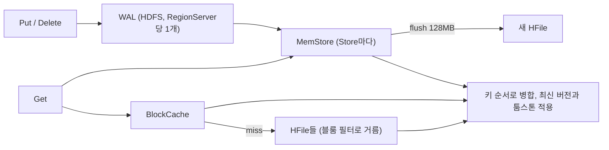

HBase에 Put을 보내고 성공 응답을 받은 순간, 그 데이터는 아직 HFile에 없다. WAL과 메모리에만 있다. 이 상태에서 RegionServer가 죽으면 무엇이 데이터를 되살리는지, 읽기는 왜 메모리와 파일 여러 개를 함께 봐야 하는지 설명할 수 있으면 HMaster, 리전, compaction 질문도 같이 풀린다.

나는 음악 서비스에서 HBase를 저장소로 쓰는 개인화 API를 만들었다. 행 키 설계, Get과 Scan, Spark에서 쓰는 방법은 [HBase 행 키 글](/posts/hbase-serving-row-keys/)에 정리했다.

버전은 HBase 2.6 기준이다.

## 핵심 키워드

| 키워드 | 한 줄 뜻 |
|---|---|
| HMaster | RegionServer 감시, 리전 배치, 테이블 생성 같은 메타데이터 변경 담당 |
| RegionServer | 리전을 맡아 읽기와 쓰기를 직접 처리 |
| 리전 | 테이블을 행 키 범위로 자른 조각, 한 시점에 RegionServer 하나가 맡는다 |
| hbase:meta | 모든 리전의 키 범위와 위치를 담은 시스템 테이블 |
| ZooKeeper | 활성 HMaster 선출, RegionServer 생존 감시, meta 위치 저장 |
| WAL | RegionServer마다 하나, MemStore보다 먼저 쓰는 변경 로그 |
| MemStore | 리전의 컬럼 패밀리(Store)마다 있는 쓰기 버퍼, 차면 HFile로 flush |
| HFile | HDFS에 저장되는 정렬된 불변 파일 |
| BlockCache | 읽은 HFile 블록을 RegionServer 메모리에 두는 캐시 |
| 블룸 필터 | Get에서 그 행이 없는 HFile을 건너뛰게 하는 HFile별 필터 |
| minor / major compaction | 작은 HFile 몇 개를 합치기 / Store의 HFile을 하나로 합치며 툼스톤까지 제거 |
| 툼스톤 | 삭제를 나타내는 표시, major compaction 때까지 남는다 |

## 클라이언트는 meta를 보고 RegionServer로 바로 간다

테이블은 행 키 범위로 나뉜 리전의 모음이고, 리전 하나는 한 시점에 RegionServer 하나가 맡는다. 리전 안에는 컬럼 패밀리마다 Store가 하나씩 있고, Store는 MemStore 하나와 HFile 여러 개로 이뤄진다.

클라이언트가 행 하나를 읽거나 쓰려면 그 행을 가진 리전을 먼저 찾는다. 2.x 기본 설정(`ZKConnectionRegistry`)에서는 ZooKeeper에서 hbase:meta의 위치를 얻고, meta에서 행 키가 속한 리전과 RegionServer 주소를 읽는다. 그다음부터는 HMaster를 거치지 않고 RegionServer에 직접 요청한다. 찾은 위치는 클라이언트가 캐시하고, 리전이 옮겨졌거나 서버가 죽어 요청이 실패하면 meta를 다시 읽는다.

HMaster는 데이터 경로에 없다. RegionServer 장애 처리, 리전 배치와 밸런싱, 분할 마무리, 테이블 생성 같은 메타데이터 변경을 맡는다. 그래서 2.x에서는 HMaster가 잠시 내려가도 읽기와 쓰기는 이어진다. 3.0부터는 기본 설정에서 클라이언트 기본 레지스트리가 HMaster RPC(`RpcConnectionRegistry`)로 바뀌어서, 연결을 맺으려면 활성이든 대기든 HMaster가 하나는 떠 있어야 한다.

ZooKeeper는 세 가지를 맡는다. HMaster 여러 대 중 활성 하나를 정하고, RegionServer마다 ephemeral 노드를 두어 세션이 끊기면 HMaster가 그 서버를 죽은 것으로 처리하게 하고, meta 위치를 저장한다.

## 쓰기는 WAL에 남긴 뒤 MemStore에 들어간다



RegionServer는 Put과 Delete를 먼저 WAL에 기록하고, 그다음 해당 Store의 MemStore에 넣는다. WAL 쓰기가 실패하면 연산 전체가 실패한다. WAL은 HDFS `/hbase/WALs/` 아래에 RegionServer마다 하나 있고, 그 서버의 리전이 같이 쓴다. meta를 가진 서버만 meta 전용 WAL을 하나 더 둔다.

MemStore가 `hbase.hregion.memstore.flush.size`(기본 128MB)를 넘으면 정렬된 내용을 새 HFile로 내린다. HFile은 한번 쓰면 바꾸지 않으므로 flush마다 파일이 하나씩 늘어난다. 한 Store의 파일 수가 `hbase.hstore.blockingStoreFiles`(기본 16)를 넘으면 그 리전의 쓰기는 compaction이 끝나거나 대기 시간이 지날 때까지 막힌다.

WAL을 건너뛰는 선택지도 있다. 연산이나 테이블 단위 Durability를 `SKIP_WAL`로 두면 WAL을 쓰지 않고, `ASYNC_WAL`은 동기화를 기다리지 않고 응답한다. 둘 다 서버가 죽으면 데이터를 잃을 수 있다. 벌크 로드는 HFile을 직접 만들어 WAL과 MemStore를 건너뛴다.

## 읽기는 MemStore와 HFile 여러 개를 합친다

한 행의 셀은 MemStore와 HFile 여러 개에 흩어져 있을 수 있다. 읽기는 MemStore와 각 HFile을 키 순서로 합쳐 셀마다 최신 버전을 고르고, 툼스톤이 가린 셀은 빼고 돌려준다.

HFile 블록을 읽을 때는 BlockCache를 먼저 본다. 기본은 힙 안의 `LruBlockCache`이고 크기는 `hfile.block.cache.size`(기본 힙의 0.4)로 정한다. BucketCache를 켜면 데이터 블록은 BucketCache(보통 off-heap)로 가고, 인덱스와 블룸 블록은 LRU 쪽에 남는다.

블룸 필터는 HFile마다 메타데이터로 저장되고, 블룸 블록은 필요할 때 BlockCache로 읽힌다. Get에서 그 행이 들어 있을 가능성이 있는 HFile만 읽게 해서 디스크 읽기를 줄인다. 기본값은 `ROW`이고 칸 단위로 거르는 `ROWCOL`도 있다. `ROW` 블룸은 Get처럼 행 하나를 읽을 때만 쓰이고, 고정 길이 접두사 Scan에는 `ROWPREFIX_FIXED_LENGTH`를 쓴다. 결국 읽기 비용은 Store당 HFile 수에 따라 커지고, 그 수를 줄이는 일이 compaction이다.

## compaction이 끝나야 삭제가 실제로 지워진다

| 구분 | 대상 | 결과 | 삭제 처리 |
|---|---|---|---|
| minor | 작고 인접한 HFile 몇 개 | 더 적고 큰 HFile | 툼스톤은 남기고, 고른 파일 안의 가려진 셀과 만료·넘친 버전은 지운다 |
| major | Store의 HFile 전부 | Store당 HFile 하나 | 툼스톤이 가린 데이터와 툼스톤, 넘친 버전을 지운다 |

Delete는 데이터를 바로 지우지 않고 툼스톤을 쓴다. 읽기에서는 툼스톤이 가린다. 툼스톤 자체와, 같은 minor compaction에 들어가지 않은 파일의 가려진 셀은 major compaction 때까지 남는다. 그래서 대량으로 지운 직후에는 용량이 거의 줄지 않는다. TTL로 만료된 데이터는 툼스톤 없이 compaction 때 걸러진다.

major compaction은 기본 7일(`hbase.hregion.majorcompaction`)마다 지터 0.5를 섞어 돌고, 0으로 두면 시간 기반 자동 실행만 꺼진다. 모든 파일을 다시 쓰는 작업이라 서비스에 방해가 되면 한가한 시간대에 돌게 설정하거나 셸과 Admin API로 직접 돌린다. 아예 안 돌리면 툼스톤과 파일이 계속 쌓인다.

## 분할은 부하를 나누지만 핫스팟을 다 풀지는 못한다

기본 분할 정책은 `SteppingSplitPolicy`다. 그 RegionServer에 테이블의 리전이 하나뿐이면 flush 크기의 두 배(256MB)에서, 아니면 `hbase.hregion.max.filesize`(기본 10GB)에서 나눈다. 테이블이 처음엔 빨리 여러 서버로 퍼지고, 그 뒤로는 리전 수가 크게 늘지 않게 하는 설계다.

분할은 RegionServer가 정하고 HMaster와 함께 마무리한다. 부모 리전을 flush한 뒤 딸 리전 둘은 데이터를 복사하지 않고 부모 HFile의 위·아래 절반을 가리키는 reference 파일을 갖는다. 이 reference는 compaction으로 실제 파일이 되며, 그 전에는 딸 리전을 다시 나눌 수 없다. meta에는 부모가 offline으로, 딸 둘이 새 리전으로 기록된다.

리전 하나는 서버 하나가 맡으므로, 특정 키 범위로 몰리는 트래픽은 그 서버 하나가 받는다. 행 키가 시간이나 순번으로 시작하면 분할을 해도 새 쓰기는 늘 마지막 딸 리전으로 간다. 분할은 키 분포를 바꾸지 않으므로 이 문제는 행 키 설계와 pre-split로 푼다. 그 방법은 행 키 글에 있다.

## 일관성은 행 하나 단위로 강하다

행 하나는 리전 하나에, 리전 하나는 서버 하나에 있으므로 읽기는 그 서버가 마지막으로 성공시킨 쓰기를 본다. 원자성도 행 단위다. 한 행에 대한 mutation은 컬럼 패밀리 여러 개에 걸쳐도 전부 되거나 전부 안 된다. 여러 행을 한 번에 보내는 batch는 행마다 성공과 실패가 따로 나온다. Scan은 테이블 전체의 스냅샷이 아니고, 돌려주는 각 행이 어느 시점에 실제로 있던 완전한 행일 뿐이다.

읽고 비교해서 쓰는 작업은 `checkAndMutate`로 서버에서 원자적으로 한다.

```java
// HBase 2.6 클라이언트 API
Put put = new Put(row).addColumn(CF, Bytes.toBytes("status"), Bytes.toBytes("DONE"));
CheckAndMutate cam = CheckAndMutate.newBuilder(row)
    .ifEquals(CF, Bytes.toBytes("status"), Bytes.toBytes("PENDING"))
    .build(put);
boolean applied = table.checkAndMutate(cam).isSuccess();
```

region replica를 켜면 보조 리전도 읽기를 받을 수 있다. 이때 읽기 요청에 `Consistency.TIMELINE`을 주면 조금 지난 값이 올 수 있고, 기본값은 `STRONG`이다. 쓰기는 여전히 주 리전으로만 간다.

## RegionServer가 죽으면 WAL을 리전별로 나눠 다시 적용한다

RegionServer의 ZooKeeper 세션이 끊기면 HMaster가 `ServerCrashProcedure`를 시작한다. 2.x 기본(`hbase.split.wal.zk.coordinated=false`)에서는 `SplitWALManager`가 WAL 파일마다 프로시저를 만들어 살아 있는 RegionServer에 분할을 맡긴다. WAL 하나에는 여러 리전의 수정이 섞여 있으므로, 이를 리전별로 묶는 과정이 log splitting이다. 리전이 다른 서버에서 열릴 때 자기 몫의 수정을 다시 적용하면 flush되지 않았던 MemStore 내용이 돌아온다.

그 사이 죽은 서버의 리전은 읽기도 쓰기도 받지 못한다. 행 단위 강한 일관성을 고른 대가로, 복구가 끝날 때까지 그 키 범위는 잠시 쓸 수 없다.

## Cassandra, Bigtable과 나란히 놓으면

| 항목 | HBase | Cassandra | Bigtable |
|---|---|---|---|
| 데이터 분배 | 행 키 범위 리전, 서버 하나가 담당 | 파티션 키 해시, 복제본 여러 개가 모두 쓰기를 받음 | 연속된 행 묶음인 tablet, HBase 리전에 해당 |
| 쓰기 경로 | WAL, MemStore, HFile | commit log, memtable, SSTable | 관리형, SSTable 형식으로 저장 |
| 일관성 | 행 단위 강한 일관성 | 연산마다 consistency level(ONE, QUORUM, ALL 등) 선택 | 단일 클러스터는 강한 일관성, 복제 클러스터 사이는 eventual |

세 시스템 모두 메모리 버퍼와 불변 정렬 파일, compaction이라는 같은 뼈대를 쓴다. 갈리는 곳은 키 범위의 주인을 하나로 둘지, 여러 복제본이 다 받게 할지다. HBase는 주인을 하나로 두어 일관성을 얻고, 장애 복구 시간만큼 가용성을 낸다.

## 참고 자료

- [Apache HBase Reference Guide (book)](https://hbase.apache.org/book.html): Catalog Tables, Client, Master, WAL, WAL Splitting, Durability, Block Cache, Bloom Filters, Compaction, Region Splits, Timeline Consistency
- [Apache HBase ACID Semantics](https://hbase.apache.org/acid-semantics.html)
- [hbase-default.xml (rel/2.6.7)](https://github.com/apache/hbase/blob/rel/2.6.7/hbase-common/src/main/resources/hbase-default.xml)
- [SteppingSplitPolicy (rel/2.6.7)](https://github.com/apache/hbase/blob/rel/2.6.7/hbase-server/src/main/java/org/apache/hadoop/hbase/regionserver/SteppingSplitPolicy.java)
- [HBase 2.6 Javadoc: CheckAndMutate](https://hbase.apache.org/2.6/apidocs/org/apache/hadoop/hbase/client/CheckAndMutate.html)
- [Apache HBase Downloads](https://hbase.apache.org/downloads.html)
- [Apache Cassandra: Dynamo](https://cassandra.apache.org/doc/latest/cassandra/architecture/dynamo.html), [Storage Engine](https://cassandra.apache.org/doc/latest/cassandra/architecture/storage-engine.html)
- [Google Cloud Bigtable overview](https://cloud.google.com/bigtable/docs/overview), [Replication overview](https://cloud.google.com/bigtable/docs/replication-overview), [Writes](https://cloud.google.com/bigtable/docs/writes)

## English summary

I built a personalization API on HBase for a music service, and this post follows what the server does under that kind of API. A client finds a region through hbase:meta and then talks to the RegionServer directly, and the HMaster stays out of the data path in 2.x. A write goes to the WAL first and then to the MemStore, which flushes to immutable HFiles, so a read must merge the MemStore and several HFiles with help from the BlockCache and bloom filters. Deletes only write tombstones until a major compaction removes the data. Because one RegionServer owns each row range, HBase gives strong per-row consistency, and the trade-off is that a crashed server's regions stay unavailable until their WAL edits are replayed elsewhere.
