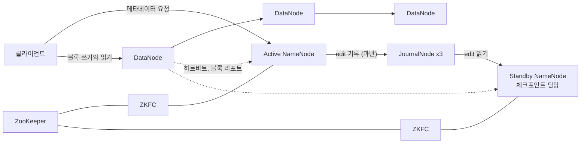

HDFS에서 파일 하나를 더 만들 때 드는 비용은 디스크보다 NameNode 메모리에 먼저 붙는다. 데이터 블록은 DataNode 수백 대에 흩어지지만, 그 파일과 블록이 어디 있는지는 NameNode 한 프로세스의 메모리에 다 올라가기 때문이다. HDFS의 장점과 한계는 거의 다 이 구조에서 나온다.

[Spark Streaming으로 HDFS에 쌓은 로그 파이프라인](/posts/spark-streaming-to-hive/)은 HDFS에 텍스트를 append하고, 임시 폴더 이름을 바꿔 끼우고, 작은 파일을 합치는 잡을 따로 뒀다. 그 세 동작이 HDFS 안에서 얼마짜리 일인지를 기준으로 구조를 따라간다.

버전은 Hadoop 3.5.0(2026년 4월 릴리스) 기준이다.

## 핵심 키워드

| 키워드 | 한 줄 뜻 |
|---|---|
| NameNode | 네임스페이스(디렉터리, 파일, 블록 목록)와 블록 위치를 메모리에 두는 마스터 |
| DataNode | 블록을 로컬 디스크에 저장하고 하트비트와 블록 리포트를 보내는 워커 |
| 블록 | 파일을 나눈 단위, `dfs.blocksize` 기본 128MB |
| fsimage, edit log | 네임스페이스 스냅숏 파일과 그 뒤의 변경 로그 |
| 체크포인트 | edit log를 fsimage에 합쳐 새 fsimage를 만드는 일, HA에서는 Standby가 한다 |
| 복제 계수 | 블록 복제본 수, `dfs.replication` 기본 3 |
| rack awareness | 복제본을 랙 두 곳에 나눠 두는 배치 규칙 |
| JournalNode, ZKFC | 공유 edit log 저장소, NameNode 장애 감지와 자동 failover 담당 |
| erasure coding | 복제 대신 패리티 블록으로 내구성을 얻는 Hadoop 3 방식 |
| shuffle | map 출력을 reducer별로 나눠 가져가고 키 순서로 병합하는 단계 |
| combiner, partitioner | map 쪽 부분 집계, 키를 reducer 번호로 바꾸는 함수 |

## NameNode는 메모리에 지도를 들고 있다



NameNode는 네임스페이스와 블록 맵을 메모리에 둔다. 파일 열기, 이름 바꾸기, 목록 조회는 디스크를 거치지 않고 이 메모리에서 끝난다. 변경은 edit log에 먼저 남기고, 디스크의 fsimage는 어느 시점의 네임스페이스 전체 스냅숏이다. NameNode가 재시작하면 fsimage를 읽고 그 뒤의 edit를 다시 적용한다.

edit log가 길어지면 재시작이 느려지므로 체크포인트로 둘을 합친다. `dfs.namenode.checkpoint.period`(기본 3600초)와 `dfs.namenode.checkpoint.txns`(기본 100만 건) 중 먼저 닿는 쪽이 체크포인트를 일으킨다. 블록이 어느 DataNode에 있는지는 fsimage에 없다. DataNode가 시작할 때와 주기적으로(`dfs.blockreport.intervalMsec`, 기본 6시간) 보내는 블록 리포트로 NameNode가 다시 채운다. 그래서 NameNode는 시작 직후 safemode에 들어가 복제를 멈추고, 블록의 99.9%(`dfs.namenode.safemode.threshold-pct`)가 보고될 때까지 기다린다. 하트비트는 3초마다 오고, 끊기면 기본 설정에서 10분 30초(재확인 간격 5분의 두 배에 하트비트 간격 3초의 10배) 뒤에 그 노드를 죽은 것으로 보고 블록을 다른 노드에 다시 복제한다.

## 작은 파일은 객체 수만큼 NameNode 힙을 쓴다

파일, 디렉터리, 블록은 NameNode 메모리에서 각각 객체 하나다. Cloudera 블로그의 경험칙은 객체당 약 150바이트이고, 블록 하나짜리 파일 천만 개면 파일과 블록 객체 2천만 개로 3GB쯤 된다. 공식 수치가 아니라 힙 크기를 어림하는 값이다. 같은 1GB도 모양에 따라 객체 수가 크게 다르다.

| 1GB를 담는 방식 | 파일 객체 | 블록 객체 | 합계 |
|---|---|---|---|
| 128MB 파일 8개 | 8 | 8 | 16 |
| 1MB 파일 1,024개 | 1,024 | 1,024 | 2,048 |

1MB 파일이 디스크에서 128MB를 차지하지는 않는다. 블록은 실제 데이터 크기만큼만 쓴다. 비용은 객체 수, 블록 리포트 크기, 파일마다 NameNode에 보내는 RPC에 붙는다. 엔진별로 파일 수를 줄이는 방법은 [작은 파일 글](/posts/small-files-and-compaction/)에 정리했다. 위 파이프라인이 20초마다 새 파일을 만드는 대신 이벤트 시각 파일 끝에 append한 것도 파일 수 쪽에서는 유리한 선택이다. 대신 작은 쓰기가 많아지고, 남은 파일은 합치기 잡이 정리했다.

## 쓰기는 파이프라인으로, 읽기는 가까운 복제본에서

쓰기에서 클라이언트는 NameNode에 새 블록을 요청하고 DataNode 세 곳의 목록을 받는다. 데이터는 64KB 패킷(`dfs.client-write-packet-size`)으로 첫 DataNode에 가고, 첫 노드는 받은 것을 저장하며 둘째 노드로 넘기고, 둘째가 셋째로 넘긴다. 확인 응답은 반대 방향으로 돌아온다. 중간 노드가 죽으면 파이프라인을 남은 노드로 다시 짜서 쓰기를 이어 가고, 모자란 복제본은 NameNode가 나중에 채운다. 다만 기본 정책(`dfs.client.block.write.replace-datanode-on-failure.policy=DEFAULT`)에서 append나 hflush한 블록이면 클라이언트가 새 DataNode를 파이프라인에 끼운다.

복제본 세 개의 자리는 rack awareness가 정한다. 첫째는 쓰는 쪽이 DataNode면 그 노드, 아니면 같은 랙의 임의 노드에 둔다. 둘째는 다른 랙의 노드, 셋째는 둘째와 같은 랙의 다른 노드에 둔다. 랙 하나가 통째로 꺼져도 복제본이 남고, 랙 사이 쓰기 트래픽은 한 번으로 줄어든다. HDFS 파일은 한 번 쓰고 닫으면 append와 truncate 말고는 바꿀 수 없고, 한 시점에 writer는 하나다.

읽기에서는 NameNode가 블록 위치를 클라이언트와 가까운 순서로 정렬해 주고, 클라이언트는 DataNode에서 직접 읽는다. 데이터는 NameNode를 지나가지 않고, 체크섬이 맞지 않으면 다른 복제본으로 넘어간다. data locality는 이 위치 정보를 스케줄러가 쓰는 것이다. MapReduce와 Spark는 입력 split의 블록 위치를 받아 그 노드, 안 되면 그 랙에 태스크를 먼저 놓는다. Spark는 `spark.locality.wait`(기본 3초)만큼 더 가까운 자리를 기다린다. YARN이 그 자리에 컨테이너를 어떻게 주는지는 [Spark on YARN 자원 글](/posts/spark-on-yarn-resources/)에 있다.

## HA는 edit log를 JournalNode 과반에 나눠 쓴다

NameNode 하나로는 그 프로세스가 단일 장애점이다. QJM 방식 HA에서 Active는 변경을 JournalNode 과반에 기록하고, Standby는 JournalNode에서 edit를 읽어 자기 네임스페이스에 적용한다. JournalNode는 최소 3개이고, N개면 (N-1)/2개 장애까지 견딘다. DataNode는 두 NameNode 모두에 하트비트와 블록 리포트를 보내므로 Standby도 블록 위치를 이미 알고 있다. 이 구성에서 체크포인트는 Standby가 한다. Secondary NameNode를 따로 두면 설정 오류다.

자동 failover는 NameNode 호스트마다 하나씩 도는 ZKFC가 맡는다. ZKFC는 로컬 NameNode의 상태를 주기적으로 확인하고, 건강한 동안 ZooKeeper 세션을 유지한다. Active 쪽 ZKFC는 ephemeral lock znode를 쥐고 있다. 그 세션이 끊기면 다른 ZKFC가 lock을 잡고, 필요하면 옛 Active를 fencing한 뒤 자기 NameNode를 Active로 올린다. JournalNode는 writer를 하나만 받으므로 두 NameNode가 동시에 edit를 쓰지는 못한다. fencing이 여전히 필요한 이유는 옛 Active가 쓰기에 실패하기 전까지 낡은 읽기를 내줄 수 있어서다. `dfs.ha.automatic-failover.enabled`의 기본값은 false라서 자동 failover는 켜야 동작한다.

```bash
# Hadoop 3.5.0
hdfs haadmin -getServiceState nn1          # active / standby
hdfs fsck /logs/2026-11-20 -files -blocks -locations
hdfs ec -setPolicy -path /archive -policy RS-6-3-1024k
```

## erasure coding은 저장 공간을 아끼고 append를 내준다

3복제는 저장 공간을 200% 더 쓴다. Hadoop 3의 erasure coding은 RS(6,3)이면 데이터 블록 6개에 패리티 3개를 붙여 50%만 더 쓰고, 블록 3개를 잃어도 복구한다. 파일은 1MB 셀 단위로 블록 그룹에 줄무늬처럼 나뉘어 저장된다. 기본으로 켜진 정책은 `RS-6-3-1024k` 하나다. 정책은 디렉터리에 걸고, 그 아래 새로 만드는 파일만 따른다. 기존 파일을 바꾸려면 복사해서 다시 써야 한다. 대가도 분명하다.

| 항목 | 3복제 | RS-6-3 |
|---|---|---|
| 추가 저장 공간 | 200% | 50% |
| 필요한 DataNode | 3 | 최소 9, 랙 장애까지 견디려면 랙 3개 이상 |
| append, truncate | 가능 | `IOException` (닫힌 파일에 NEW_BLOCK append만 허용) |
| hflush, hsync | 동작한다 | 아무 일도 하지 않는다 |
| 읽기 | 복제본 하나를 로컬에서 | 대부분 다른 노드와 랙에서, 복구에 CPU 사용 |

그래서 erasure coding은 잘 읽지 않는 warm, cold 데이터에 맞는다. 위 파이프라인처럼 같은 파일 끝에 계속 붙여 쓰는 경로는 3복제 디렉터리에 있어야 한다.

## S3는 rename이 복사이고 디렉터리가 없다

| 항목 | HDFS | S3 (S3A 커넥터) |
|---|---|---|
| 일관성 | NameNode 하나가 판단, 쓰고 닫으면 바로 보인다 | 2020년 12월부터 PUT, DELETE, LIST 모두 강한 read-after-write |
| rename | NameNode 메타데이터만 바꾸는 원자적 연산 | 객체마다 복사 후 삭제, 시간은 파일 수와 크기에 비례, 디렉터리 rename은 원자적이지 않다 |
| 디렉터리 | 실제 inode | 키 접두사를 디렉터리처럼 흉내 낸다 |
| 목록 조회 | NameNode 메모리 조회 | 요청당 키 1,000개씩 페이지로 받는 LIST |
| locality | 블록이 있는 노드에서 계산 가능 | 계산과 저장이 분리되어 locality가 없다 |
| 확장 한계 | NameNode 힙 | 접두사당 요청 속도 |

임시 경로에 쓰고 이름을 바꿔 끼우는 방식은 HDFS에서 싸다. 데이터는 움직이지 않고 NameNode의 트리만 바뀐다. 로그 파이프라인의 일 배치가 `_TMP` 경로에 쓰고 원래 폴더와 바꿔 끼운 것도 이 성질에 기댄다. 같은 방식을 S3에서 쓰면 모든 바이트를 다시 복사하고, 중간에 실패하면 반쯤 옮겨진 상태가 남는다. 그래서 S3에 직접 결과를 쓸 때는 rename에 기대지 않는 S3A committer(magic, staging)를 쓰고, Iceberg 같은 테이블 포맷은 커밋을 카탈로그의 포인터 교체로 옮겼다.

## MapReduce는 map과 reduce 사이를 정렬로 잇는다

MapReduce 잡은 map, shuffle, sort, reduce로 흐른다. map 출력은 메모리 버퍼(`mapreduce.task.io.sort.mb`, 기본 100MB)에 쌓이다가 80%(`mapreduce.map.sort.spill.percent`)에서 로컬 디스크로 spill된다. 레코드를 버퍼에 넣을 때 partitioner가 reducer 번호를 정하고, spill할 때 파티션별로 키 정렬한다. 중간 출력은 NodeManager 로컬 디렉터리(`yarn.nodemanager.local-dirs`)에 남고, NodeManager의 `mapreduce_shuffle` 보조 서비스가 reducer에게 내준다. reducer는 map 출력을 가져오면서(shuffle) 동시에 병합 정렬하고, 같은 키의 값을 모아 reduce를 부른다. 최종 출력만 HDFS에 쓴다.

```java
// Hadoop 3.5.0 MapReduce API, 단어 세기
Job job = Job.getInstance(conf, "word count");
job.setMapperClass(TokenizerMapper.class);
job.setCombinerClass(IntSumReducer.class);       // map 쪽 부분 합
job.setReducerClass(IntSumReducer.class);
job.setPartitionerClass(HashPartitioner.class);  // 기본값과 같다
job.setNumReduceTasks(4);                         // 기본 1
```

combiner는 정렬된 출력을 디스크에 쓸 때 미리 줄여 shuffle 양을 줄인다. 프레임워크가 map과 reduce 태스크 양쪽에서 0번, 1번, 여러 번 부를 수 있으므로 합, 최댓값처럼 교환·결합 법칙이 성립하는 연산이어야 한다. 평균은 (합, 개수)를 넘기도록 바꿔야 한다. 기본 partitioner인 `HashPartitioner`는 키 해시를 reducer 수로 나눈 나머지를 쓴다. 파티션 수는 reducer 수와 같고, 한 키에 값이 몰리면 그 reducer 하나가 잡 전체를 붙잡는다.

## Spark가 MapReduce를 대신한 이유

MapReduce 잡 하나는 map 한 번과 reduce 한 번이다. 조인 뒤에 집계하고 다시 정렬하는 일은 잡 여러 개를 이어야 하고, 잡 사이 중간 결과는 매번 HDFS에 3복제로 쓰였다가 다시 읽힌다. 반복 계산은 반복마다 이 비용을 낸다. Spark는 연산 전체를 DAG 하나로 받아 셔플 경계에서만 stage를 나눈다. stage 사이 셔플 파일은 MapReduce처럼 로컬 디스크에 남지만, 중간 결과를 HDFS에 복제해 쓰는 단계는 없다. 두 번 이상 읽는 데이터는 메모리에 cache할 수 있다. 그 실행 과정은 [Spark 실행 모델 글](/posts/spark-execution-model/)에 있다. Hive도 실행 엔진 기본값을 Tez로 옮겼고, 그 사정은 [Hive 테이블 글](/posts/hive-tables-serde-and-acid/)에 있다. 그래도 map 쪽에서 파티션별로 정렬해 로컬 디스크에 쓰고 reduce 쪽이 가져가는 셔플의 뼈대는 Spark에도 그대로 남았다.

## 참고 자료

- Hadoop 3.5.0: [Releases](https://hadoop.apache.org/releases.html), [HDFS Architecture](https://hadoop.apache.org/docs/r3.5.0/hadoop-project-dist/hadoop-hdfs/HdfsDesign.html), [hdfs-default.xml](https://hadoop.apache.org/docs/r3.5.0/hadoop-project-dist/hadoop-hdfs/hdfs-default.xml), [HDFS HA with QJM](https://hadoop.apache.org/docs/r3.5.0/hadoop-project-dist/hadoop-hdfs/HDFSHighAvailabilityWithQJM.html), [HDFS Erasure Coding](https://hadoop.apache.org/docs/r3.5.0/hadoop-project-dist/hadoop-hdfs/HDFSErasureCoding.html)
- Hadoop 3.5.0 MapReduce: [MapReduce Tutorial](https://hadoop.apache.org/docs/r3.5.0/hadoop-mapreduce-client/hadoop-mapreduce-client-core/MapReduceTutorial.html), [mapred-default.xml](https://hadoop.apache.org/docs/r3.5.0/hadoop-mapreduce-client/hadoop-mapreduce-client-core/mapred-default.xml), [JobConf Javadoc (combiner)](https://hadoop.apache.org/docs/r3.5.0/api/org/apache/hadoop/mapred/JobConf.html)
- Hadoop 3.5.0 S3A: [hadoop-aws](https://hadoop.apache.org/docs/r3.5.0/hadoop-aws/tools/hadoop-aws/index.html)
- AWS: [Amazon S3 data consistency model](https://docs.aws.amazon.com/AmazonS3/latest/userguide/Welcome.html#ConsistencyModel), [S3 strong read-after-write consistency (2020-12-01)](https://aws.amazon.com/about-aws/whats-new/2020/12/amazon-s3-now-delivers-strong-read-after-write-consistency-automatically-for-all-applications/)
- Cloudera: [The Small Files Problem (2009)](https://www.cloudera.com/blog/technical/the-small-files-problem.html)
- Spark: [Configuration (spark.locality.wait)](https://spark.apache.org/docs/latest/configuration.html)

## English summary

HDFS keeps the whole namespace and block map in one NameNode's memory, while DataNodes hold 128MB blocks with three replicas spread over two racks. That design makes metadata operations like rename cheap and lets schedulers run tasks next to the data, but every file and block costs NameNode heap, roughly 150 bytes per object by Cloudera's rule of thumb. HA shares the edit log through a JournalNode quorum, and ZKFC with ZooKeeper handles automatic failover, while erasure coding in Hadoop 3 cuts storage overhead from 200% to 50% at the cost of append and locality. In my Spark Streaming log pipeline I appended to HDFS files and swapped a temp folder in by rename, both of which rely on HDFS semantics that S3 does not give. MapReduce wrote every intermediate job result back to HDFS, and Spark kept the same sort-based shuffle but removed those writes between steps.
