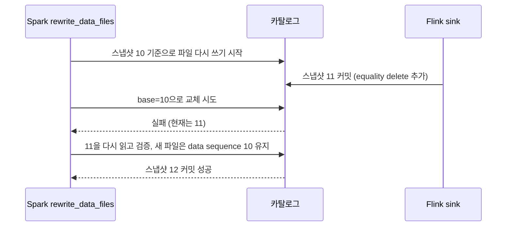

Flink가 체크포인트마다 커밋하는 Iceberg 테이블에 Spark compaction이 같은 순간 커밋하면 둘 중 하나는 진다. 진 쪽이 다시 시도하는지, 실패하는지, 남의 커밋을 덮어쓰는지는 카탈로그와 작업 종류가 정한다. Athena가 `CATALOG_NOT_FOUND`를 내는 일이나, 배치 잡이 충돌하면 처음부터 다시 읽어야 하는 이유도 이 층에 있다.

메타데이터 트리는 [Iceberg 테이블 포맷 글](/posts/iceberg-table-format/)에, 격리 수준별 검사 항목은 [행 단위 삭제 글](/posts/iceberg-row-level-deletes/)에 있다.

버전은 Iceberg 1.12.0, 같은 태그의 REST 카탈로그 OpenAPI 스펙, 2026년 11월 AWS 문서 기준이다.

## 카탈로그가 들고 있는 건 metadata.json 위치 하나다

Iceberg 테이블의 상태는 모두 스토리지의 파일에 있다. 카탈로그가 테이블마다 갖는 것은 현재 `metadata.json`의 위치 문자열이다. 커밋은 새 메타데이터 파일을 다 써 둔 뒤, 이 문자열이 아직 내가 읽은 값(base)일 때만 새 값으로 바꾸는 compare-and-swap 한 번이다. 바꾸는 순간 새 스냅샷이 보이고, 못 바꾸면 써 둔 파일은 아무도 참조하지 않는다.

JDBC 카탈로그에서는 이 동작이 SQL 한 문장으로 보인다. 1.12 `JdbcUtil`의 커밋 문장을 줄이면 이렇다. 바뀐 행이 1이 아니면 `CommitFailedException`이다.

```sql
UPDATE iceberg_tables
SET metadata_location = :new, previous_metadata_location = :base
WHERE catalog_name = :c AND table_namespace = :ns AND table_name = :t
  AND metadata_location = :base;
```

카탈로그마다 이 비교와 교체를 원자적으로 만드는 장치가 다르다.

| 카탈로그 | 포인터를 두는 곳 | 원자성을 만드는 장치 |
|---|---|---|
| Hive Metastore | HMS 테이블 파라미터 `metadata_location` | 기본은 HMS 락. 락을 끄면 `alter_table`에 기대값을 실어 보낸다 |
| AWS Glue | Glue 테이블 파라미터 | `UpdateTable`에 읽을 때 받은 `VersionId`를 실어 보내는 낙관적 락 |
| JDBC | `iceberg_tables` 행 | 위 `UPDATE ... WHERE metadata_location = :base` |
| REST | 서버가 정한다 | 클라이언트는 조건과 변경만 보내고 서버가 검증, 교체한다 |
| Hadoop | 디렉터리의 `vN.metadata.json` | 파일 rename. 원자적 rename이 없는 S3에서는 보장이 없다 |

Hive 카탈로그는 `iceberg.engine.hive.lock-enabled`가 기본 `true`라 HMS에 락을 만들고 획득을 확인한 뒤 교체한다. 락 없이 커밋하려면 HMS에 HIVE-26882(MySQL·MariaDB 백엔드면 HIVE-28121도)가 있어야 하고, 같은 테이블에 쓰는 모든 HiveCatalog가 Iceberg 1.3 이상이면서 다 같이 락을 꺼야 한다. 락을 쓰는 writer와 안 쓰는 writer가 섞이면 테이블이 깨질 수 있다. Glue는 AWS SDK 2.17.131 이상이면 `VersionId` 비교로 충분하고, 그보다 낮으면 JVM 안의 락만 걸려 DynamoDB 락 매니저가 따로 필요하다. Glue는 `glue.skip-archive`가 기본 `true`라 커밋마다 Glue 테이블 버전을 남기지 않는다. 끄면 스트리밍 테이블에서 버전이 빠르게 쌓인다. 같은 HMS를 써도 [Hive 파티션 글](/posts/hive-partitions-and-metastore/)의 Hive 스타일 테이블에는 테이블 단위 커밋이 없었고, Iceberg는 포인터 하나만 맡기니 커밋 단위가 테이블 전체가 된다.

## REST 카탈로그는 커밋 판단을 서버로 옮긴다

REST 클라이언트는 메타데이터 파일을 직접 쓰고 포인터를 바꾸지 않는다. `POST /v1/{prefix}/namespaces/{namespace}/tables/{table}`로 requirements와 updates를 보낸다. Java 클라이언트가 스냅샷 하나를 추가할 때 보내는 내용은 대략 이렇다.

```json
{
  "requirements": [
    {"type": "assert-table-uuid", "uuid": "9c12d441-03fe-4693-9a96-a0705ddf69c1"},
    {"type": "assert-ref-snapshot-id", "ref": "main", "snapshot-id": 3051729675574597004}
  ],
  "updates": [
    {"action": "add-snapshot", "snapshot": {"snapshot-id": 5937117119577207079, "...": "..."}},
    {"action": "set-snapshot-ref", "ref-name": "main", "type": "branch", "snapshot-id": 5937117119577207079}
  ]
}
```

서버는 requirements를 현재 메타데이터에 대 보고, 하나라도 틀리면 409(`CommitFailedException`)를 돌려준다. 클라이언트는 테이블을 다시 읽고 변경을 다시 만들어 보낸다. 500, 502, 504는 커밋 여부를 모르는 상태다. 첫 요청이 성공했을 수도 있으니 서버가 `idempotency-key-lifetime`을 알려 주면 클라이언트가 `Idempotency-Key` 헤더를 붙여 같은 변경이 두 번 들어가지 않게 한다. 여러 테이블을 한 번에 커밋하는 `POST /v1/{prefix}/transactions/commit`도 스펙에 있지만 서버가 꼭 구현할 필요는 없다.

서버가 커밋을 쥐면 권한도 쥔다. 테이블을 불러올 때 서버가 테이블 경로로 범위를 좁힌 단기 자격 증명(`storage-credentials`)을 내려주는 credential vending이 스펙에 있고, 클라이언트는 `X-Iceberg-Access-Delegation` 헤더로 이를 요청한다. 클라이언트에게 S3 권한이 없어도 카탈로그가 허락하면 읽고, S3 권한이 있어도 카탈로그가 막으면 테이블이 보이지 않는다. 예를 들어 IAM 권한은 충분해도 Lake Formation이 관리하는 연합 카탈로그 `s3tablescatalog/<버킷>`에 그랜트가 없으면, Athena는 `CATALOG_NOT_FOUND`를 낼 수 있다.

Apache Polaris는 이 REST 스펙을 구현한 오픈소스 카탈로그 서버다. Nessie는 여러 테이블에 걸친 트랜잭션과 브랜치, 태그 같은 Git식 작업을 카탈로그 수준에서 제공한다.

## S3 Tables는 관리형 카탈로그를 세 가지 입구로 연다

| 입구 | 설정 | 비고 |
|---|---|---|
| S3 Tables Iceberg REST 엔드포인트 | `uri=https://s3tables.<region>.amazonaws.com/iceberg`, warehouse는 테이블 버킷 ARN, SigV4 서명 이름 `s3tables` | 버킷 하나에 기본 읽기·쓰기 |
| AWS Glue Iceberg REST 엔드포인트 | `uri=https://glue.<region>.amazonaws.com/iceberg`, warehouse `<계정>:s3tablescatalog/<버킷>`, 서명 이름 `glue` | Lake Formation 그랜트로 권한 관리 |
| S3 Tables Catalog for Apache Iceberg | `catalog-impl=software.amazon.s3tables.iceberg.S3TablesCatalog` | 클라이언트 라이브러리 |

어느 입구든 포인터 교체는 S3 Tables API `UpdateTableMetadataLocation`이 맡는다. 요청에 새 메타데이터 위치와 읽을 때 받은 `versionToken`을 싣고, 그사이 다른 쓰기가 있었으면 409 `ConflictException`이 난다. Glue의 `VersionId`와 같은 낙관적 락이다.

S3 Tables REST 엔드포인트에는 제약이 있다. `stage-create`를 지원하지 않아 CTAS가 400으로 실패하고, `purge` 없는 DROP도 400이다. `metadata.json`이 50MB를 넘는 테이블은 작업 자체가 400으로 거부된다. Athena도 `metadata.json`이 너무 크면 에러를 내는데, 그 파일은 스냅샷 목록을 품고 있어 스냅샷 만료가 크기를 줄이는 수단이 된다. 테이블 이름 패턴은 `[0-9a-z_]*`라 대문자가 들어갈 자리가 없다. [Kafka Connect 대소문자 글](/posts/iceberg-kafka-connect-mixed-case/)에서 동적 라우팅이 테이블 이름을 소문자로 바꾸던 동작은 이런 카탈로그에서는 드러나지 않았을 것이다(추론).

## 진 writer는 다시 읽고 검증한 뒤 다시 쓴다

Java 구현의 `SnapshotProducer.commit()`은 `CommitFailedException`에서만 재시도한다. 재시도마다 테이블을 새로 읽고, 새 상태 위에서 변경을 다시 적용하고, 작업별 검증을 돌리고, 매니페스트 리스트를 새로 써서 다시 교체를 시도한다. append가 새로 만든 매니페스트처럼 상태와 무관한 결과물은 다시 쓰지 않는다. 횟수와 간격은 테이블 속성이다. `commit.retry.num-retries` 기본 4(최대 5번 시도), 대기 시간은 `min-wait-ms` 100ms에서 2배씩 늘어 `max-wait-ms` 60초까지, 전체 상한 `total-timeout-ms`는 30분이다.

커밋 상태를 모를 때(`CommitStateUnknownException`)는 재시도하지 않고 써 둔 파일도 지우지 않는다. 실제로 성공했다면 그 파일이 테이블의 일부이기 때문이다. Glue와 Hive 카탈로그는 이때 포인터를 다시 읽어 내 메타데이터 위치가 들어갔는지 확인한다.

검증 내용은 작업마다 다르다. append는 검증 없이 그대로 다시 붙는다. compaction(`RewriteFiles`)은 바꿀 입력 파일이 아직 있는지, 그 파일에 새 position delete나 deletion vector가 붙지 않았는지 본다. overwrite와 row delta는 `validateFromSnapshot`과 격리 수준만큼 검사한다. 1.12의 Kafka Connect sink는 조상 스냅샷 요약에 남은 오프셋이 코디네이터가 기대한 값과 같은지 확인해, 같은 묶음을 두 번 커밋하지 않는다.

검증 실패는 `ValidationException`이고 이건 재시도 대상이 아니다. 포인터 경합은 Iceberg가 알아서 풀지만, 가정이 깨진 작업은 호출한 쪽이 처음부터 다시 해야 한다. 예를 들어 중복 제거 잡이 `validate-from-snapshot-id`로 실패하면 최신 스냅샷으로 다시 읽어 몇 번 재시도하고, 끝까지 충돌하면 스케줄러에 실패로 보이게 하는 것이 그 바깥 재시도다.

## Flink 스트리밍과 Spark compaction이 같은 테이블에 커밋할 때

Flink sink는 체크포인트마다 커밋하고, upsert면 equality delete가 든 row delta를 쓴다. 1.12 `IcebergFilesCommitter`는 이 row delta에 검증을 걸지 않는다. equality delete는 sequence number가 더 작은 모든 데이터 파일에 붙으니, 재시도로 순서가 뒤로 밀려도 결과가 틀리지 않기 때문이다. Flink 쪽은 포인터 경합에서 져도 다시 붙으면 된다.



Spark 쪽이 버티는 열쇠는 `rewrite_data_files`의 `use-starting-sequence-number`(기본 `true`)다. 다시 쓴 파일에 compaction 시작 시점의 sequence number를 붙이니, 그사이 Flink가 더한 equality delete가 새 파일에도 그대로 적용된다. 그래서 검증에서 equality delete를 건너뛸 수 있다. 이 옵션을 끄면 새 파일이 더 높은 번호를 받아 삭제가 적용되지 않으니, 새 equality delete가 있을 때 검증이 실패해야 한다.

compaction이 실제로 지는 경우는 입력 파일이 사라졌거나, 그 파일에 Spark merge-on-read `DELETE`의 position delete나 deletion vector가 붙었을 때다. 커밋이 아주 잦으면 재시도 횟수를 다 쓰기도 한다. 진 작업은 이미 읽고 쓴 비용을 버리고, 상대가 그 작업의 한 주기보다 자주 커밋하면 계속 지는 livelock이 된다. `partial-progress.enabled`로 파일 그룹마다 나눠 커밋하면 한 번 질 때 버리는 양이 줄어든다. 경합이 잦으면 sink 커밋 주기를 늘리거나 compaction 목표 파일 크기를 낮추는 방법이 있다. 둘 다 경합의 빈도나 한 번에 버리는 양을 줄이는 쪽이다.

## S3 경로만으로 여는 HadoopCatalog는 경합을 막지 못한다

`HadoopCatalog`는 카탈로그 서버 없이 디렉터리를 테이블로 쓴다. 커밋은 임시 메타데이터 파일을 쓰고, `vN+1.metadata.json`이 없으면 그 이름으로 rename한다. HDFS에서는 rename이 원자적이고 대상이 있으면 실패하니 compare-and-swap이 된다. S3에는 원자적 rename이 없어서, 존재 확인과 rename 사이에 다른 writer가 끼면 같은 버전 파일을 둘이 쓰고 나중 쪽만 남는다. 먼저 쓴 writer는 성공으로 알고 끝나지만 그 커밋은 히스토리에서 사라진다. 기본 락 매니저는 JVM 메모리 안의 락이라 다른 프로세스는 막지 못한다. 경로 기반 테이블에 `lock-impl`로 DynamoDB 락 매니저를 붙이는 방법은 있지만, S3 위의 동시 쓰기라면 카탈로그를 두는 편이 단순하다.

로컬에서는 이 구조를 눈으로 볼 수 있다. Spark 4.1.x와 Iceberg 1.12.0 기준이다.

```bash
spark-sql \
  --packages org.apache.iceberg:iceberg-spark-runtime-4.1_2.13:1.12.0 \
  --conf spark.sql.extensions=org.apache.iceberg.spark.extensions.IcebergSparkSessionExtensions \
  --conf spark.sql.catalog.local=org.apache.iceberg.spark.SparkCatalog \
  --conf spark.sql.catalog.local.type=hadoop \
  --conf spark.sql.catalog.local.warehouse=file:///tmp/iceberg_wh \
  -e "CREATE TABLE local.db.t (id bigint, v string) USING iceberg
        TBLPROPERTIES ('commit.retry.num-retries'='10');
      INSERT INTO local.db.t VALUES (1, 'a');
      INSERT INTO local.db.t VALUES (2, 'b');
      SELECT timestamp, file, latest_snapshot_id FROM local.db.t.metadata_log_entries;"

ls /tmp/iceberg_wh/db/t/metadata/   # v1~v3.metadata.json, version-hint.text, 매니페스트
cat /tmp/iceberg_wh/db/t/metadata/version-hint.text   # 3
```

`metadata_log_entries`의 마지막 `file`이 지금 포인터다. 이 카탈로그에서는 포인터가 파일 이름의 숫자와 `version-hint.text`라서, 파일 시스템의 rename 의미가 곧 커밋의 원자성이다.

## 참고 자료

- Iceberg 문서: [Reliability](https://iceberg.apache.org/docs/latest/reliability/), [Configuration](https://iceberg.apache.org/docs/latest/configuration/), [Catalog Properties](https://iceberg.apache.org/docs/latest/catalog-properties/), [AWS (Glue)](https://iceberg.apache.org/docs/latest/aws/), [JDBC](https://iceberg.apache.org/docs/latest/jdbc/), [Nessie](https://iceberg.apache.org/docs/latest/nessie/), [Java API quickstart (Hadoop catalog)](https://iceberg.apache.org/docs/latest/java-api-quickstart/), [Spark Procedures](https://iceberg.apache.org/docs/latest/spark-procedures/)
- [Iceberg REST Catalog Protocol](https://iceberg.apache.org/docs/latest/rest-protocol/), [REST Catalog OpenAPI spec 1.12.0](https://github.com/apache/iceberg/blob/apache-iceberg-1.12.0/open-api/rest-catalog-open-api.yaml)
- apache/iceberg 1.12.0 소스: [SnapshotProducer](https://github.com/apache/iceberg/blob/apache-iceberg-1.12.0/core/src/main/java/org/apache/iceberg/SnapshotProducer.java), [MergingSnapshotProducer](https://github.com/apache/iceberg/blob/apache-iceberg-1.12.0/core/src/main/java/org/apache/iceberg/MergingSnapshotProducer.java), [JdbcUtil](https://github.com/apache/iceberg/blob/apache-iceberg-1.12.0/core/src/main/java/org/apache/iceberg/jdbc/JdbcUtil.java), [HadoopTableOperations](https://github.com/apache/iceberg/blob/apache-iceberg-1.12.0/core/src/main/java/org/apache/iceberg/hadoop/HadoopTableOperations.java), [HiveTableOperations](https://github.com/apache/iceberg/blob/apache-iceberg-1.12.0/hive-metastore/src/main/java/org/apache/iceberg/hive/HiveTableOperations.java), [GlueTableOperations](https://github.com/apache/iceberg/blob/apache-iceberg-1.12.0/aws/src/main/java/org/apache/iceberg/aws/glue/GlueTableOperations.java), [Flink IcebergFilesCommitter](https://github.com/apache/iceberg/blob/apache-iceberg-1.12.0/flink/v2.1/flink/src/main/java/org/apache/iceberg/flink/sink/IcebergFilesCommitter.java), [Kafka Connect Coordinator](https://github.com/apache/iceberg/blob/apache-iceberg-1.12.0/kafka-connect/kafka-connect/src/main/java/org/apache/iceberg/connect/channel/Coordinator.java)
- AWS: [S3 Tables Iceberg REST endpoint](https://docs.aws.amazon.com/AmazonS3/latest/userguide/s3-tables-integrating-open-source.html), [Glue Iceberg REST endpoint로 S3 Tables 접근](https://docs.aws.amazon.com/AmazonS3/latest/userguide/s3-tables-integrating-glue-endpoint.html), [UpdateTableMetadataLocation API](https://docs.aws.amazon.com/AmazonS3/latest/API/API_s3Buckets_UpdateTableMetadataLocation.html), [awslabs/s3-tables-catalog](https://github.com/awslabs/s3-tables-catalog)
- [Apache Polaris](https://polaris.apache.org/)

## English summary

An Iceberg catalog stores one thing per table, the location of the current metadata.json, and a commit is a compare-and-swap of that pointer, done with a Hive lock, a Glue version ID, a conditional SQL update, or server-side checks in a REST catalog. A writer that loses the swap reloads the table, re-runs the checks for its operation, and tries again up to four retries by default, while a failed validation is not retried and must be handled by the caller. Flink upsert commits skip validation, and Spark compaction keeps its starting sequence number, so the two can share a table and mostly just retry. With S3 Tables the catalog is also the access gate, so Athena cannot see tables until Lake Formation grants are in place, and a batch job whose validation fails needs its own retry on top of Iceberg's. A plain S3 path with HadoopCatalog has no atomic rename, so the trade-off is between running a catalog service and risking silently lost commits.
