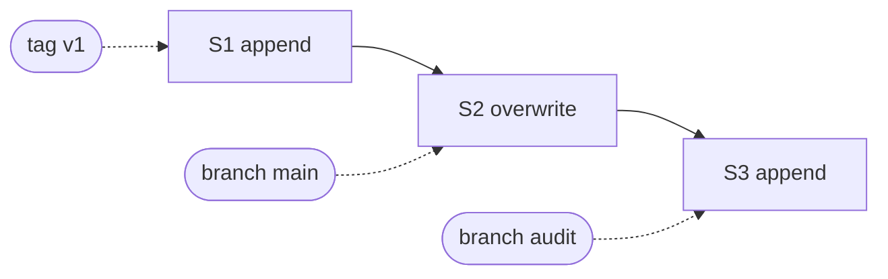

배치가 잘못된 값으로 Iceberg 테이블을 덮어썼다면 데이터 파일을 복구할 필요는 없다. 테이블이 가리키는 스냅샷을 이전 것으로 옮기면 된다. 다만 그 스냅샷이 아직 만료되지 않았어야 하고, 그 뒤에 다른 writer가 커밋한 스냅샷은 같이 밀려난다. sink가 몇 분마다 커밋하는 테이블에서는 둘 다 운영 문제가 된다.

메타데이터 트리와 기본 시간 여행 문법은 [Iceberg 테이블 포맷 글](/posts/iceberg-table-format/)에 적었다. 그 글에서 한 단락으로 넘긴 스냅샷의 연산, 이름 붙이기, 수명을 이어서 쓴다.

버전은 Iceberg 1.12.0과 같은 태그의 테이블 스펙, Spark 4.1 기준이다.

## 커밋 하나가 스냅샷 하나이고, operation은 파일 변화로 정해진다

스냅샷에는 ID, 부모 스냅샷 ID, sequence number, 커밋 시각, 매니페스트 리스트 위치, 요약(summary)이 있다. 부모 ID를 따라가면 계보(lineage)가 나온다. 요약의 `operation`은 스펙상 네 값 중 하나이고, SQL 명령 이름이 아니라 커밋이 더하고 뺀 파일로 정해진다. 1.12.0 core의 `BaseOverwriteFiles`, `BaseRowDelta`, `BaseRewriteFiles` 기준이다.

| 커밋 예 | 파일 변화 | operation |
|---|---|---|
| `INSERT INTO` | 데이터 파일 추가만 | `append` |
| copy-on-write `UPDATE`, `DELETE` | 데이터 파일 추가와 제거 | `overwrite` (제거만 있으면 `delete`) |
| merge-on-read `DELETE` | delete 파일 추가만 | `delete` |
| upsert, merge-on-read `UPDATE` | 데이터 파일과 delete 파일 추가 | `overwrite` |
| `rewrite_data_files` | 내용은 그대로 두고 파일 교체 | `replace` |

copy-on-write와 merge-on-read의 차이는 [행 단위 삭제 글](/posts/iceberg-row-level-deletes/)에 있다. 이 구분이 중요한 이유는 스냅샷 만료, 증분 읽기, cherry-pick이 모두 `operation`을 보고 동작을 바꾸기 때문이다. upsert를 지원하는 스트리밍 sink처럼 row delta로 커밋하는 writer는 `append`와 `overwrite`를 섞어 남긴다.

요약에는 `total-data-files`, `total-delete-files` 같은 누적 수치도 있다. 예를 들어 중복 제거 잡이라면 데이터 파일을 열기 전에 최신 스냅샷 요약의 이 두 값으로 테이블을 거르고, 읽은 스냅샷 ID를 `validate-from-snapshot-id`로 넘겨 그 뒤의 커밋과 충돌하면 실패하게 할 수 있다. 스냅샷 ID가 낙관적 커밋의 기준점 역할을 한다.

## 시간 여행은 두 가지 기록을 따로 본다

메타데이터에는 계보 말고 `snapshot-log`도 있다. 현재 스냅샷이 바뀔 때마다 시각과 스냅샷 ID를 한 줄씩 남기는 기록이다. 스펙은 시각 기준 조회에 이 기록을 쓰게 한다. 그래서 `TIMESTAMP AS OF`는 그 시각에 실제로 현재였던 스냅샷을 돌려주고, 나중에 되돌려 계보에서 빠진 스냅샷이라도 그때 현재였다면 그것을 읽는다.

`VERSION AS OF`는 스냅샷 ID(long)나 브랜치·태그 이름(문자열)을 받는다. 스키마 선택도 다르다. 스냅샷 ID, 시각, 태그로 읽으면 그 스냅샷의 스키마를 쓰고, 브랜치로 읽으면 테이블의 현재 스키마를 쓴다. 스키마는 브랜치마다 따로 있지 않고 테이블에 하나다.

`history` 메타데이터 테이블은 `snapshot-log`를 보여 주고, 되돌려서 현재 계보에서 빠진 스냅샷은 `is_current_ancestor`가 `false`로 나온다.

## 되돌리기는 포인터만 옮기고, 그 뒤 커밋도 같이 밀어낸다

| 프로시저 | 하는 일 | 제약 |
|---|---|---|
| `rollback_to_snapshot` | 현재 스냅샷을 지정한 ID로 | 현재 상태의 조상이어야 함 |
| `rollback_to_timestamp` | 그 시각 이전의 가장 최근 조상으로 | 조상만 |
| `set_current_snapshot` | 지정한 ID나 브랜치·태그로 | 조상이 아니어도 됨 |
| `cherrypick_snapshot` | 기존 스냅샷의 변경을 새 스냅샷으로 다시 적용 | `append`와 dynamic overwrite만 |

잘못된 덮어쓰기가 S5였고 sink가 S6~S9를 계속 append했다고 하자. S4로 되돌리면 S6~S9의 행도 현재 테이블에서 빠진다. 스냅샷 자체는 만료 전까지 남아 있으니, `append`라면 하나씩 cherry-pick해 다시 얹을 수 있다. sink가 upsert로 남긴 `overwrite` 스냅샷은 dynamic overwrite가 아니라서 cherry-pick 대상이 아니고, 그 구간은 원천에서 다시 받아야 한다. 되돌리기 전에 `snapshots` 테이블의 `operation` 열부터 보는 이유다.

## 브랜치와 태그는 스냅샷에 붙인 이름이다

브랜치와 태그는 메타데이터의 `refs` 맵에 들어가는 이름 붙은 참조다. 태그는 스냅샷 하나에 고정되고, 브랜치는 새 커밋을 받을 때마다 머리가 움직이는 별도 계보다. 테이블의 현재 상태는 `main` 브랜치의 머리다.



참조마다 보존 정책이 따로 붙는다. `max-ref-age-ms`는 참조 자체를 언제 지울지 정하고 `main`을 뺀 모든 참조에 쓴다. 기본값은 영원이다. `min-snapshots-to-keep`과 `max-snapshot-age-ms`는 브랜치에만 있고, 그 브랜치 계보에서 몇 개, 얼마나 오래된 스냅샷까지 남길지 정한다. 값이 없으면 테이블 속성 `history.expire.*`를 따른다.

브랜치로 write-audit-publish(WAP)를 만들 수 있다. 테이블에 `write.wap.enabled=true`를 걸고, 브랜치를 만든 뒤 세션에 `spark.wap.branch`를 주면 쓰기가 그 브랜치로 간다. 1.12.0 Spark 4.1 모듈의 `SparkTableUtil`을 보면 같은 세션에서 브랜치를 지정하지 않은 읽기도 그 브랜치가 있으면 그쪽을 읽는다. 검증 쿼리를 쓰던 그대로 돌릴 수 있고, 다른 세션의 독자는 계속 `main`을 본다. 검증이 끝나면 `fast_forward`로 `main`을 브랜치 머리로 옮긴다. `fast_forward`는 `main`의 현재 스냅샷이 브랜치 머리의 조상일 때만 성공하니, 검증하는 사이 `main`에 다른 커밋이 들어왔다면 실패한다. 브랜치 없이 하는 WAP도 남아 있다. `spark.wap.id`를 주면 스냅샷을 현재로 만들지 않고 쌓아 두고, `publish_changes`가 그 스냅샷을 새 스냅샷으로 다시 적용한다.

[데이터 품질 검사 글](/posts/data-quality-checks/)의 일 배치는 `_TMP` 경로에 다 쓴 뒤 원래 폴더와 바꿔 끼웠다. 쓰는 도중 실패해도 원본이 남는다는 점에서 같은 목적이다. Iceberg 브랜치는 경로를 바꾸는 대신 참조를 옮기고, 검증 전 상태가 스냅샷으로 남는다. 대가도 있다. S3 Tables의 관리형 snapshot management는 사용자 태그·브랜치나 `history.expire.max-snapshot-age-ms`, `history.expire.min-snapshots-to-keep` 속성이 있는 테이블에서 실패한다. 관리형 만료를 쓰는 테이블에 WAP 브랜치를 들이면 만료를 직접 돌려야 한다.

## 로컬에서 따라 해 보기

Spark 4.1 `spark-sql`과 Iceberg 1.12.0 runtime으로 로컬 파일 시스템 카탈로그를 띄운다.

```bash
spark-sql --packages org.apache.iceberg:iceberg-spark-runtime-4.1_2.13:1.12.0 \
  --conf spark.sql.extensions=org.apache.iceberg.spark.extensions.IcebergSparkSessionExtensions \
  --conf spark.sql.catalog.local=org.apache.iceberg.spark.SparkCatalog \
  --conf spark.sql.catalog.local.type=hadoop \
  --conf spark.sql.catalog.local.warehouse=/tmp/iceberg-wh
```

```sql
CREATE TABLE local.db.orders (id bigint, status string) USING iceberg
TBLPROPERTIES ('write.wap.enabled' = 'true');

INSERT INTO local.db.orders VALUES (1, 'paid'), (2, 'paid');        -- S1 append
ALTER TABLE local.db.orders CREATE TAG `v1`;
UPDATE local.db.orders SET status = 'refunded' WHERE id = 2;       -- S2 overwrite

ALTER TABLE local.db.orders CREATE BRANCH `audit` RETAIN 7 DAYS;
SET spark.wap.branch = audit;
INSERT INTO local.db.orders VALUES (3, 'paid');                     -- S3, audit에만
SELECT count(*) FROM local.db.orders;                               -- 3, 이 세션은 audit을 읽는다
SELECT count(*) FROM local.db.orders VERSION AS OF 'main';          -- 2
RESET spark.wap.branch;
CALL local.system.fast_forward('db.orders', 'main', 'audit');

CALL local.system.set_current_snapshot(table => 'db.orders', ref => 'v1');
SELECT snapshot_id, parent_id, is_current_ancestor FROM local.db.orders.history;
SELECT name, type, snapshot_id FROM local.db.orders.refs;

-- 실습용으로 audit을 지우고 미래 시각을 줘서 retain_last만 남긴다
ALTER TABLE local.db.orders DROP BRANCH `audit`;
CALL local.system.expire_snapshots(
  table => 'db.orders', older_than => TIMESTAMP '2100-01-01 00:00:00', retain_last => 1);
```

마지막 단계에서 S1은 `main`과 태그 `v1`이 잡고 있어서 남는다. S2와 S3는 만료되고, 두 스냅샷이 새로 쓴 데이터 파일과 매니페스트가 지운 개수로 출력된다.

## 만료는 스냅샷을 지우고, 그 스냅샷만 쓰던 파일을 지운다

`expire_snapshots`는 스펙의 보존 규칙대로 남길 스냅샷 집합을 만든다. 오래된 참조(`main` 제외)를 지우고, 남은 참조가 가리키는 스냅샷을 넣고, 브랜치마다 `max-snapshot-age-ms`보다 새롭거나 최근 `min-snapshots-to-keep`개 안에 드는 조상을 넣는다. 집합 밖의 스냅샷은 메타데이터에서 빠지고, 남은 스냅샷이 참조하지 않는 파일만 지운다.

프로시저 기본값은 `older_than` 5일 전, `retain_last` 1이다. 둘 다 생략하면 테이블 속성 `history.expire.max-snapshot-age-ms`(기본 5일)와 `history.expire.min-snapshots-to-keep`(기본 1)을 쓴다. 출력은 지운 데이터 파일, position delete 파일, equality delete 파일, 매니페스트, 매니페스트 리스트, 통계 파일 수다. 파일 목록이 크면 `stream_results => true`로 드라이버에 한 번에 모으지 않게 한다. `clean_expired_metadata`를 켜면 더 이상 쓰지 않는 파티션 스펙과 스키마도 정리한다.

출력에 metadata.json이 없다는 점을 놓치기 쉽다. 커밋마다 새 metadata.json이 생기고, 그 안에 남은 스냅샷 전부와 `snapshot-log`, 이전 metadata.json 위치를 담은 `metadata-log`가 들어간다. `metadata-log`가 추적하는 개수는 `write.metadata.previous-versions-max`(기본 100)이고, 옛 파일 자체는 `write.metadata.delete-after-commit.enabled`(기본 false)를 켜야 커밋마다 지워진다. 추적에서 빠진 파일은 `remove_orphan_files`가 지운다.

파일 하나의 크기는 보존 중인 스냅샷 수에 비례한다. sink가 5분마다 커밋하면 하루 288개, 기본 보존 5일이면 테이블당 1,440개 안팎의 스냅샷이 metadata.json에 들어간다(가정에 따른 단순 계산). 이 파일이 커지면 Athena가 `The Iceberg metadata.json file retrieved for the table is too large`로 실패할 수 있고, 스냅샷 만료가 돌아 크기가 줄면 다시 통과할 것이다(추론이다).

## 스냅샷 사이를 읽는 증분 읽기는 append만 본다

Spark DataFrame 읽기에 `start-snapshot-id`(제외)와 `end-snapshot-id`(포함, 생략하면 현재)를 주면 그 사이에 추가된 데이터만 읽는다. SQL 문법으로는 쓸 수 없고, `append` 스냅샷만 읽는다. Structured Streaming 읽기는 `overwrite`나 `delete` 스냅샷을 만나면 기본으로 예외를 던지고, `streaming-skip-overwrite-snapshots`, `streaming-skip-delete-snapshots`로 건너뛸 수만 있다.

삭제와 갱신까지 보려면 `create_changelog_view`가 있다. 두 스냅샷이나 두 시각 사이의 변경을 `_change_type`(`INSERT`, `DELETE`, `UPDATE_BEFORE`, `UPDATE_AFTER`), `_change_ordinal`, `_commit_snapshot_id`와 함께 뷰로 만들고, `net_changes`로 중간 변경을 접는다. 1.12.0 core의 `BaseIncrementalChangelogScan`은 `replace` 스냅샷을 건너뛰고, 구간에 delete 파일이 있는 스냅샷이 있으면 `Delete files are currently not supported in changelog scans`로 멈춘다. upsert sink가 쓰는 merge-on-read 테이블에서는 이 경로가 막힌다. 그런 테이블의 하류가 바뀐 행만 받으려면 Kafka 토픽을 직접 읽는 쪽이 남는다(추론).

## 참고 자료

- [Apache Iceberg Table Spec (Snapshots, Snapshot References, Snapshot Retention Policy, Point in Time Reads)](https://iceberg.apache.org/spec/)
- [Iceberg Branching and Tagging](https://iceberg.apache.org/docs/latest/branching/)
- [Iceberg Spark Procedures (snapshot management, expire_snapshots, create_changelog_view)](https://iceberg.apache.org/docs/latest/spark-procedures/)
- [Iceberg Spark Queries (time travel, incremental read, history, refs)](https://iceberg.apache.org/docs/latest/spark-queries/)
- [Iceberg Spark Writes (writing to branches, WAP)](https://iceberg.apache.org/docs/latest/spark-writes/)
- [Iceberg Spark DDL (branching and tagging DDL)](https://iceberg.apache.org/docs/latest/spark-ddl/)
- [Iceberg Spark Structured Streaming](https://iceberg.apache.org/docs/latest/spark-structured-streaming/)
- [Iceberg Configuration (history.expire.*, write.metadata.*, write.wap.enabled)](https://iceberg.apache.org/docs/latest/configuration/)
- [Iceberg Maintenance (expire snapshots, remove old metadata files)](https://iceberg.apache.org/docs/latest/maintenance/)
- [apache/iceberg 1.12.0 BaseRowDelta.java](https://github.com/apache/iceberg/blob/apache-iceberg-1.12.0/core/src/main/java/org/apache/iceberg/BaseRowDelta.java)
- [apache/iceberg 1.12.0 UpdateSnapshotReferencesOperation.java (fast-forward)](https://github.com/apache/iceberg/blob/apache-iceberg-1.12.0/core/src/main/java/org/apache/iceberg/UpdateSnapshotReferencesOperation.java)
- [apache/iceberg 1.12.0 BaseIncrementalChangelogScan.java](https://github.com/apache/iceberg/blob/apache-iceberg-1.12.0/core/src/main/java/org/apache/iceberg/BaseIncrementalChangelogScan.java)
- [apache/iceberg 1.12.0 SparkTableUtil.java (Spark 4.1, WAP branch)](https://github.com/apache/iceberg/blob/apache-iceberg-1.12.0/spark/v4.1/spark/src/main/java/org/apache/iceberg/spark/SparkTableUtil.java)

## English summary

Every Iceberg commit creates a snapshot, and its operation (append, overwrite, delete, replace) comes from the files it adds and removes, not from the SQL verb. Rolling back only moves the current pointer, so later commits drop out too, and only append snapshots can be cherry-picked back. Branches and tags are named references with their own retention, and a branch gives write-audit-publish without swapping paths. A batch job can use the snapshot ID it read as its conflict check, and on S3 Tables managed snapshot expiry does not run on tables with user branches or tags. A WAP branch buys a safe publish step at the cost of running snapshot expiry yourself.
