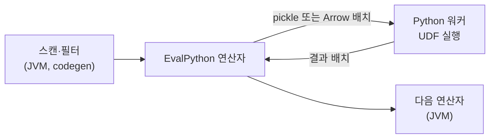

PySpark에서 `df.select(F.length("s"))`와 `@udf`로 감싼 `len(s)`는 결과가 같다. 그런데 실행 경로는 전혀 다르다. 앞은 executor JVM 안에서 끝나고, 뒤는 행마다 JVM에서 Python 프로세스로 건너갔다가 돌아온다. Arrow는 이 건너가는 비용을 줄이지만 Catalyst가 함수 안을 못 보는 문제는 그대로 남는다.

[PySpark 지표 배치 글](/posts/pyspark-indicator-batch/)의 배치는 query builder가 SQL 문자열을 만들고 `spark.sql`이 계산하는 구조였다. 글에 적은 구조대로라면 Python은 드라이버에서 SQL을 조립할 뿐이고, 행은 Python 워커로 건너가지 않는다.

버전은 Spark 4.3.0(2026-10-30 릴리스) 기준이다.

## 핵심 키워드

| 키워드 | 한 줄 뜻 |
|---|---|
| Python 워커 | executor JVM 옆에 뜨는 별도 Python 프로세스. 동시에 도는 태스크 수만큼 늘고 기본으로 재사용된다 |
| pickled UDF | 행을 pickle로 직렬화해 보내고 함수를 행마다 부르는 전통적인 Python UDF |
| `BatchEvalPython` / `ArrowEvalPython` | pickled UDF / Arrow 배치를 쓰는 UDF를 실행하는 물리 연산자 |
| Arrow 레코드 배치 | 열 단위로 메모리에 놓인 행 묶음. JVM과 Python이 같은 형식을 읽는다 |
| Arrow-optimized Python UDF | 일반 `@udf`지만 전송만 Arrow로 하는 방식. 4.2부터 기본 |
| pandas UDF | 배치 하나를 `pandas.Series`로 받아 한 번에 계산하는 벡터화 UDF |
| `maxRecordsPerBatch` | Arrow 배치 하나의 최대 행 수, 기본 10,000 |
| `mapInPandas` / `mapInArrow` | 파티션을 배치 iterator로 받아 아무 길이의 결과를 돌려주는 API |
| `applyInPandas` | 그룹 하나를 pandas DataFrame 하나로 받아 처리하는 API |
| `spark.executor.pyspark.memory` | Python 워커 메모리 상한. 주지 않으면 제한이 없다 |
| Spark Connect | 클라이언트가 계획만 보내고 서버 클러스터가 실행하는 구조. UDF는 cloudpickle로 실려 간다 |

## 행은 JVM에서 Python 워커로 건너간다

DataFrame 연산은 executor JVM 안에서 `UnsafeRow`로 돈다. Python UDF가 계획에 있으면 executor는 Python 워커 프로세스를 띄우고 로컬 소켓으로 데이터를 보낸다. 워커는 `spark.python.worker.reuse`(기본 true)에 따라 태스크가 끝나도 살아 있다가 다음 태스크를 받는다.



pickled UDF에서 이 왕복은 이렇게 생겼다. JVM은 `InternalRow`를 Java 객체로 바꾸고 Pyrolite로 pickle한다. 행을 100개씩 묶어 보내고 4.0부터는 이 수를 `spark.sql.execution.python.udf.maxRecordsPerBatch`로 바꿀 수 있지만, Python 쪽은 배치를 unpickle해 행마다 Python 객체를 만들고 함수를 행마다 한 번씩 부른다. 결과도 같은 길을 거꾸로 온다. 행마다 객체 변환과 직렬화가 왕복으로 붙고 Python 함수 호출이 한 번씩 더해진다. 행 수가 억 단위면 이 고정 비용이 계산 자체보다 커진다.

## Catalyst는 UDF 안을 보지 못한다

Catalyst에게 Python UDF는 입력 컬럼과 반환 타입만 아는 블랙박스다. 그래서 두 가지를 잃는다. 첫째, UDF를 쓴 조건은 데이터 소스로 내려가지 않는다. `F.col("dt") >= "2026-11-01"`은 Parquet 스캔의 PushedFilters에 들어가 row group을 건너뛰지만, 같은 비교를 UDF로 감싸면 모든 행을 읽어 Python에 보낸 뒤에야 거른다.

둘째, whole-stage codegen이 UDF 앞뒤에서 끊긴다. `EvalPythonExec` 계열 연산자는 codegen을 지원하지 않는다. codegen 묶음과 `*(n)` 표시는 [Spark 실행 모델 글](/posts/spark-execution-model/)에 정리했다.

그래서 순서는 내장 함수가 먼저다. 문자열은 `regexp_extract`, `split`, JSON은 `from_json`, 배열은 `transform`과 `filter` 같은 고차 함수, 조건 분기는 `when`으로 대부분 된다. 이 함수들은 Python을 거치지 않고 codegen 안에서 돈다. UDF는 외부 라이브러리 호출이나 내장 함수로 표현하기 어려운 로직에만 남긴다.

## Arrow는 전송 형식과 호출 단위를 바꾼다

Arrow를 쓰는 경로는 파티션을 열 단위 레코드 배치로 잘라 보낸다. JVM과 Python이 같은 메모리 형식을 읽으니 행마다 객체를 만드는 pickle 단계가 사라진다. 다만 함수를 몇 번 부르는지는 UDF 종류마다 다르다.

| 종류 | 정의 | 함수 호출 단위 | 물리 연산자 |
|---|---|---|---|
| pickled UDF | `@udf(useArrow=False)` | 행 하나 | `BatchEvalPython` |
| Arrow-optimized UDF | `@udf` (4.2부터 기본) | 행 하나, 전송만 Arrow | `ArrowEvalPython` |
| pandas UDF | `@pandas_udf` | 배치 하나(`pandas.Series`) | `ArrowEvalPython` |
| Arrow UDF | `@arrow_udf` (4.1+) | 배치 하나(`pyarrow.Array`) | `ArrowEvalPython` |

Arrow-optimized UDF는 워커 소스를 보면 Arrow 열을 Python 리스트로 풀어 행마다 함수를 부른다. 전송 비용은 줄지만 Python 함수 호출 비용은 남는다. pandas UDF는 배치 하나에 함수를 한 번 부르고, 안에서 `s.str.len()` 같은 벡터 연산을 쓰면 루프가 C 코드에서 돈다. 둘의 차이는 함수 본문이 벡터 연산이냐에서 난다.

pandas UDF에서 자주 틀리는 지점은 Series가 컬럼 전체가 아니라는 것이다. Spark는 컬럼을 배치로 잘라 배치마다 함수를 부르고 결과를 이어 붙인다. `s - s.mean()`은 배치마다 다른 평균을 뺀다. 컬럼 전체 통계가 필요하면 집계를 먼저 하고 조인하거나, Series to Scalar 형태의 pandas UDF를 `groupBy().agg()`에 쓴다.

배치 크기는 `spark.sql.execution.arrow.maxRecordsPerBatch`(기본 10,000행)와 4.0에 생긴 `spark.sql.execution.arrow.maxBytesPerBatch`(기본 64MB) 중 먼저 닿는 쪽에서 끊긴다. 바이트 한도는 `toPandas`와 pandas 입력 `createDataFrame`에는 적용되지 않는다. 컬럼이 많아 배치가 무거우면 행 수 한도를 낮춘다.

## 4.2에서 기본값이 Arrow로 바뀌었다

4.2부터 `spark.sql.execution.pythonUDF.arrow.enabled`, `spark.sql.execution.pythonUDTF.arrow.enabled`, `spark.sql.execution.arrow.pyspark.enabled`가 모두 기본 true다. `useArrow`를 지정하지 않은 `@udf`도 정의 시점에 세션이 있고 pandas와 PyArrow가 설치돼 있으면 `ArrowEvalPython`으로 돈다. `useArrow=True`나 `False`를 직접 주면 설정보다 그 값이 우선한다.

업그레이드 때 결과가 달라질 수 있는 곳은 타입 변환이다. pickled UDF는 반환 값이 선언한 타입과 안 맞으면 조용히 null을 낸다. Arrow 경로는 변환이 더 일관되고, 4.1부터 `spark.sql.execution.pandas.convertToArrowArraySafely`가 기본 true라 정수 overflow나 소수 잘림을 오류로 낸다. 4.2부터는 null이 섞인 정수 컬럼이 pandas UDF에 `float64` 대신 `Int64` 같은 nullable 정수 dtype으로 들어온다. 이전 버전에서 null로 묻히던 타입 오류가 업그레이드 뒤 잡 실패로 드러날 수 있다. 되돌리려면 위 설정을 false로 두거나 UDF에 `useArrow=False`를 준다.

## 파티션과 그룹 단위 API

`mapInPandas`와 `mapInArrow`(3.3+)는 파티션 하나를 `pandas.DataFrame`이나 `pyarrow.RecordBatch`의 iterator로 받고, 길이가 다른 결과를 돌려줘도 된다. 모델을 파티션마다 한 번만 읽어 두고 배치를 흘려보내는 식의 작업에 맞는다. `groupBy().applyInPandas()`와 4.0에 생긴 `applyInArrow()`는 그룹 하나를 통째로 받는다. `toPandas()`와 pandas 입력 `createDataFrame()`도 같은 Arrow 변환을 쓴다. `createDataFrame()`은 Arrow 변환에서 오류가 나면 Arrow 없이 다시 만든다. Arrow를 쓰든 안 쓰든 `toPandas()`는 모든 행을 드라이버로 모은다.

## Python 워커 메모리는 JVM 힙 밖에 있다

Python 워커는 executor 힙을 쓰지 않는다. 컨테이너 한도 안에서 워커가 어디에 들어가는지, `applyInPandas`의 큰 그룹이 왜 위험한지는 [Spark OOM 글](/posts/spark-memory-and-oom/)에 정리했다.

여기서 덧붙일 것은 상한이 걸리는 방식이다. `spark.executor.pyspark.memory`를 주면 Spark는 그 값을 executor에서 동시에 도는 태스크 수로 나눠 워커마다 환경 변수로 넘기고, 워커는 Linux에서 `RLIMIT_AS`로 주소 공간을 제한한다. 넘치면 할당이 실패해 컨테이너가 kill되기 전에 대개 Python 쪽 `MemoryError`로 끝난다. Windows와 macOS에서는 실제로 제한되지 않는다. 설정을 주지 않으면 워커는 `memoryOverhead`를 다른 네이티브 메모리와 나눠 쓴다. Arrow 배치는 JVM 쪽에서도 잠깐 메모리를 크게 쓴다.

## Spark Connect, UDTF, Python 데이터 소스

Spark Connect에서는 클라이언트가 UDF 함수를 cloudpickle로 직렬화하고 `3.12` 같은 Python major.minor 버전을 함께 실어 서버에 보낸다. 실행은 서버 클러스터의 Python 워커가 한다. 클라이언트와 서버 워커의 Python 버전이 다르면 `PYTHON_VERSION_MISMATCH`로 실패한다. Connect는 RDD API를 지원하지 않으므로 `rdd.mapPartitions` 같은 코드는 `mapInPandas`나 `mapInArrow`로 옮겨야 한다.

Python UDTF(3.5+)는 행 하나를 받아 여러 행을 돌려주는 테이블 함수이고, 4.2부터 Arrow가 기본이다. Python 데이터 소스 API(4.0+)는 `DataSource`와 `DataSourceReader`를 구현해 `spark.read.format(...)`으로 쓰는 소스를 Python으로 만든다. 둘 다 Python 워커에서 돌아서 위의 전송·메모리 특성을 그대로 갖는다.

## 같은 계산을 네 가지로 써 보기

`pip install "pyspark[sql]==4.3.0"`(pandas, PyArrow 포함)과 Java 17 이상이 있으면 로컬에서 돈다. `explain()`의 물리 계획에서 연산자 이름을 비교한다. `config(map=...)`은 설정 여러 개를 dict로 한 번에 넣는다. Scala 쪽 `config(Map)`을 Spark에 넣은 과정과 PySpark에 같은 API가 따라 들어간 일은 [config(Map) 글](/posts/spark-session-config-map/)에 적었다.

```python
# PySpark 4.3.0
import pandas as pd
from pyspark.sql import SparkSession, functions as F

spark = (SparkSession.builder.master("local[2]")
         .config(map={"spark.sql.execution.arrow.maxRecordsPerBatch": 10000})
         .getOrCreate())

df = spark.range(1_000_000).select(F.concat(F.lit("user-"), F.col("id").cast("string")).alias("s"))

@F.udf("long", useArrow=False)
def slen_pickle(s):
    return len(s)

@F.udf("long")  # 4.2부터 기본으로 Arrow
def slen_arrow(s):
    return len(s)

@F.pandas_udf("long")
def slen_pandas(s: pd.Series) -> pd.Series:
    return s.str.len()

df.select(F.length("s")).explain()   # Project만, *(1) codegen 안
df.select(slen_pickle("s")).explain()  # BatchEvalPython
df.select(slen_arrow("s")).explain()   # ArrowEvalPython
df.select(slen_pandas("s")).explain()  # ArrowEvalPython
```

## 참고 자료

- [PySpark: Apache Arrow in PySpark](https://spark.apache.org/docs/4.3.0/api/python/tutorial/sql/arrow_pandas.html)
- [PySpark: Upgrading PySpark (4.1, 4.2 항목)](https://spark.apache.org/docs/4.3.0/api/python/migration_guide/pyspark_upgrade.html)
- [Spark: Spark Connect Overview](https://spark.apache.org/docs/4.3.0/spark-connect-overview.html)
- [Spark: Configuration](https://spark.apache.org/docs/4.3.0/configuration.html)
- [Spark 소스: SQLConf.scala](https://github.com/apache/spark/blob/v4.3.0/sql/catalyst/src/main/scala/org/apache/spark/sql/internal/SQLConf.scala)
- [Spark 소스: ExtractPythonUDFs.scala](https://github.com/apache/spark/blob/v4.3.0/sql/core/src/main/scala/org/apache/spark/sql/execution/python/ExtractPythonUDFs.scala), [BatchEvalPythonExec.scala](https://github.com/apache/spark/blob/v4.3.0/sql/core/src/main/scala/org/apache/spark/sql/execution/python/BatchEvalPythonExec.scala)
- [Spark 소스: PythonRunner.scala](https://github.com/apache/spark/blob/v4.3.0/core/src/main/scala/org/apache/spark/api/python/PythonRunner.scala), [worker.py](https://github.com/apache/spark/blob/v4.3.0/python/pyspark/worker.py), [worker_util.py](https://github.com/apache/spark/blob/v4.3.0/python/pyspark/worker_util.py)
- [Spark 소스: connect/udf.py](https://github.com/apache/spark/blob/v4.3.0/python/pyspark/sql/connect/udf.py)

## English summary

A Python UDF makes every row leave the executor JVM for a separate Python worker, and the classic path pickles rows and calls the function once per row, so the fixed cost per row often outweighs the work. Arrow replaces pickle with columnar record batches, and since Spark 4.2 plain `@udf` uses it by default, but only pandas and Arrow UDFs also cut the number of Python calls to one per batch. Any UDF stays opaque to Catalyst, so filters inside it are not pushed to the source and whole-stage codegen stops around it. My indicator batch built SQL strings in Python and let `spark.sql` run them, which kept rows inside the JVM at the cost of expressing every metric in SQL.
