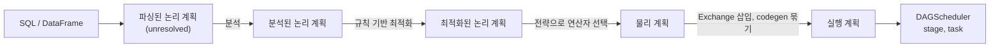

`df.filter(...).groupBy(...).agg(...)`까지 써도 클러스터에서는 아무 일도 일어나지 않는다. `count()`나 `write`를 부르는 순간 드라이버가 계획을 세우고, 셔플 지점에서 계획을 stage로 자르고, stage마다 파티션 수만큼 task를 만들어 executor에 보낸다. Spark UI의 job, stage, task 숫자와 explain의 `*(1)`이 어디서 나오는지 알면 느린 잡을 볼 때 어디부터 열어 볼지 정해진다.

이전 회사에서 음악·오디오 서비스의 데이터 쪽을 맡으며 [연말 결산 Spark SQL 잡](/posts/year-end-recap-spark/)과 [PySpark 지표 배치](/posts/pyspark-indicator-batch/)를 만들었고, 커머스 광고 플랫폼의 광고 리포트 배치에서는 Kotlin으로 Spark 잡을 썼다. 세 곳 모두 SQL 문자열을 `spark.sql`에 넘겼고, 그 뒤 실행 방식은 Spark가 정했다.

버전은 Spark 4.3.0 기준이다.

## 핵심 키워드

| 키워드 | 한 줄 뜻 |
|---|---|
| 드라이버 | main을 돌리고 SparkSession을 만들며, 계획을 세우고 task를 스케줄하는 프로세스 |
| executor | 애플리케이션마다 따로 뜨는 프로세스, 스레드로 task를 돌리고 캐시와 셔플 파일을 보관 |
| transformation / action | 계획만 늘리는 연산 / 결과를 드라이버로 가져오거나 밖에 써서 job을 시작하는 연산 |
| job | action 하나가 만든 병렬 계산 |
| stage | 셔플 경계로 자른 job의 조각, 안의 연산은 한 task에서 이어서 돈다 |
| task | 한 stage를 파티션 하나에 대해 실행하는 단위, executor 하나로 간다 |
| narrow / wide 의존 | 부모 파티션 몇 개만 보면 되는 의존 / 셔플이 필요한 `ShuffleDependency` |
| Catalyst | 분석, 논리 최적화, 물리 계획을 맡는 Spark SQL 옵티마이저 |
| Tungsten | `UnsafeRow` 같은 이진 행 형식, 메모리 관리, 코드 생성으로 CPU 효율을 높이는 실행 쪽 작업 |
| whole-stage codegen | 이어진 연산자 여러 개를 자바 함수 하나로 컴파일한 묶음, explain의 `*(n)` |
| cache / persist | 계산한 결과를 executor 메모리나 디스크에 두고 다음 action에서 재사용 |

## 드라이버는 계획하고 executor는 계산한다

드라이버는 main 함수를 실행하고 SparkSession을 만든다. 클러스터 매니저(YARN, Kubernetes, standalone)에게서 executor를 받고, 쿼리 계획을 세우고, task를 executor에 보낸다. executor는 애플리케이션이 끝날 때까지 떠 있으면서 스레드 여러 개로 task를 돌린다. YARN이 executor 컨테이너 크기를 어떻게 잡는지는 [Spark on YARN 자원 글](/posts/spark-on-yarn-resources/)에 적었다. 데이터는 보통 executor 사이에서만 오가지만 `collect()`, `take()`, `toPandas()`는 결과를 드라이버 메모리로 모은다. 광고 리포트 배치의 메일·API 잡은 `collectAsList()`로 결과를 드라이버에 모아 메일 첨부와 API 본문을 만들었다. 결과가 작다는 전제에서 코드가 단순해지는 방식이고, 결과가 큰 잡은 executor가 저장소에 직접 쓰게 해야 드라이버 메모리를 넘지 않는다.

## transformation은 계획을 쌓고 action이 job을 만든다

`select`, `filter`, `groupBy().agg()`, `join`은 결과를 계산하지 않는다. DataFrame이면 논리 계획이, RDD면 lineage가 길어질 뿐이다. `count`, `collect`, `show`, `write.save`, `foreach` 같은 action이 불릴 때 드라이버가 그 계획을 실행하고, action 하나가 job 하나를 만든다. 미루는 덕분에 action 시점에는 쿼리 전체가 보인다. 그래서 Catalyst가 쓰지 않는 컬럼을 읽지 않고, 필터를 스캔 쪽으로 내린다. 대신 계산 결과는 어디에도 남지 않으므로 같은 DataFrame에 action을 두 번 부르면 원천부터 두 번 읽는다.

## Catalyst는 계획을 네 단계로 바꾼다



분석 단계는 카탈로그를 보고 테이블, 컬럼, 타입을 확정한다. 없는 컬럼 오류는 여기서 나고, classic 모드의 DataFrame은 만드는 시점에 분석까지 하므로 action 전에 예외가 난다. 논리 최적화는 `PushDownPredicates`, `ColumnPruning`, `ConstantFolding`, `CollapseProject` 같은 규칙 묶음을 계획이 더 바뀌지 않거나 최대 반복 횟수에 닿을 때까지 반복해 적용한다.

물리 계획 단계에서는 전략들이 논리 연산자를 물리 연산자로 바꾼다. `Aggregate`는 `HashAggregate`가 되고, `Join`은 크기 추정과 조인 조건에 따라 `BroadcastHashJoin`이나 `SortMergeJoin`이 된다. 조인을 고르는 순서는 [조인 전략 글](/posts/spark-join-strategies/)에 정리했다.

"비용 기반"이라는 말은 범위가 좁다. Spark 4.3.0 소스의 `QueryExecution.createSparkPlan`은 planner가 돌려준 후보 중 첫 번째를 쓰고, 여러 물리 계획의 비용을 비교해 고르는 부분은 TODO로 남아 있다. 비용은 논리 계획의 통계(`sizeInBytes`)로 들어온다. 브로드캐스트 여부 같은 판단이 이 추정을 쓴다. `spark.sql.cbo.enabled`(기본 false)를 켜고 `ANALYZE TABLE`로 통계를 모아야 행 수와 컬럼 통계가 추정에 쓰이고, 조인 순서 재배치(`spark.sql.cbo.joinReorder.enabled`)도 따로 켜야 한다. 실행 중 실제 크기로 계획을 다시 고치는 일은 AQE(기본 true)가 한다.

## stage 경계는 셔플에서 생긴다

DAGScheduler는 RDD 그래프를 셔플 경계에서 자른다. `map`, `filter`처럼 부모 파티션 하나(또는 정해진 몇 개)만 보면 되는 narrow 의존은 한 stage 안에서 이어 붙여 task 하나가 한 번에 처리한다. `ShuffleDependency`가 있으면 앞 stage가 map 출력 파일을 쓰고, 뒤 stage는 앞 stage가 모두 끝난 뒤 그 파일을 읽는다. 앞쪽은 `ShuffleMapStage`, action을 실행하는 마지막은 `ResultStage`다.

| 연산 | 의존 | stage |
|---|---|---|
| `select`, `filter`, `withColumn`, `union` | narrow | 앞 연산과 같은 stage |
| `coalesce(n)` (셔플 없음) | narrow | 같은 stage, 파티션만 합침 |
| `groupBy().agg()`, `distinct`, `orderBy` | wide | 새 stage |
| 셔플 조인, `repartition(n)`, `OVER (PARTITION BY ...)` | wide | 새 stage |
| 브로드캐스트 조인 | 큰 쪽은 narrow | 큰 쪽은 셔플 없이 같은 stage |

SQL 계획에서는 `Exchange` 노드 하나가 셔플 하나이고 stage 경계다. 연산자가 요구하는 분포를 데이터가 못 맞추면 Spark가 `Exchange`를 넣는다. 그 규칙과 AQE가 셔플 뒤에 바꾸는 것은 [셔플과 skew 글](/posts/spark-shuffle-and-skew/)에 있다. 결산 잡의 `RANK() OVER (PARTITION BY user_id ...)`도 계획에서는 `Exchange hashpartitioning(user_id, ...)` 뒤에 `Sort`, `Window`로 나온다. AQE가 켜진 SQL 쿼리는 셔플마다 map stage를 따로 제출한다(`ShuffleExchangeExec`가 `submitMapStage` 호출). 그래서 action 하나에도 Spark UI에 job이 여러 개 보일 수 있다. UI에서 skipped로 표시되는 stage는 이미 만들어 둔 셔플 출력을 다시 써서 건너뛴 것이다.

## task 수는 각 stage의 파티션 수다

stage 하나는 파티션 수만큼 task를 만든다. 파티션 수는 stage 앞부분이 무엇이냐로 정해진다.

| stage의 시작 | 파티션 수 |
|---|---|
| 파일 스캔 | 분할 크기 `min(maxPartitionBytes 128MB, max(openCostInBytes 4MB, 전체 바이트 / 최소 파티션 수))`로 파일을 자르고 묶은 개수 |
| 셔플 뒤 | `spark.sql.shuffle.partitions`(기본 200), AQE가 작은 파티션을 합쳐 줄일 수 있다 |
| RDD 셔플, `parallelize` | 인자로 준 값, 없으면 `spark.default.parallelism` |
| `repartition(n)`, `coalesce(n)` | n, `coalesce`는 원래 수보다 늘리지 않는다 |

최소 파티션 수는 `spark.sql.files.minPartitionNum`이 없으면 기본 병렬도(보통 전체 executor 코어 수)다. 그래서 작은 입력은 코어 수만큼 잘게 나뉘고, 큰 입력은 대략 128MB씩 나뉜다. gzip 텍스트처럼 나눌 수 없는 파일은 파일 하나를 쪼개지 못한다.

한 번에 도는 task 수는 executor 수 곱하기 executor당 코어 수를 `spark.task.cpus`(기본 1)로 나눈 값이다. task가 그보다 많으면 여러 차례로 나눠 돌고, 파티션 하나가 유난히 크면 그 task 하나가 stage 끝을 붙잡는다.

## Tungsten과 whole-stage codegen

Tungsten은 실행 엔진의 CPU와 메모리 효율을 높인 작업 묶음이다. SQL 연산자는 행을 자바 객체가 아닌 `UnsafeRow`로 다룬다. 행 하나가 null 비트셋, 필드마다 8바이트 칸, 가변 길이 영역으로 된 연속 메모리여서 객체 수와 GC 부담이 준다. `spark.memory.offHeap.enabled`(기본 false)를 켜면 힙 밖 메모리도 쓴다.

whole-stage codegen(`spark.sql.codegen.wholeStage`, 기본 true)은 이어진 연산자들을 자바 함수 하나로 생성해 컴파일한다. 스캔, 필터, 프로젝트, 부분 집계가 연산자마다 iterator를 부르지 않고 한 루프 안에서 돈다. `Exchange`에서 끊기고, codegen을 지원하지 않는 식(`CodegenFallback`)이 있거나 필드가 `spark.sql.codegen.maxFields`(기본 100)를 넘는 연산자에서도 끊긴다. explain의 `*(2)`에서 2는 codegen 묶음 번호다. Spark UI의 stage ID와는 다른 번호이고, 스케줄러 stage 하나 안에 codegen 묶음이 여러 개 있을 수 있다. 예를 들어 sort-merge 조인은 `Sort` 묶음과 `SortMergeJoin` 묶음이 같은 stage에서 돈다. `*`가 없는 연산자는 생성된 코드 밖에서 해석 방식으로 돈다.

## DataFrame과 RDD는 Catalyst가 안을 볼 수 있느냐로 갈린다

DataFrame과 SQL은 스키마와 식을 Catalyst가 안다. 그래서 컬럼 가지치기, 필터 pushdown, `UnsafeRow`, codegen, 열 단위 캐시가 모두 적용된다. RDD의 `map(lambda ...)`은 Spark가 안을 볼 수 없는 함수라 이런 최적화가 없고, 행은 JVM 객체로 다닌다. PySpark에서는 차이가 더 크다. DataFrame 내장 함수는 JVM에서 돌지만, RDD 람다와 Python UDF는 Python 워커 프로세스로 데이터를 보냈다가 받아야 한다.

지표 배치는 SQL을 query builder로 만들어 `spark.sql`에 넘겼다. 계산을 SQL로 적으면 실행은 전부 JVM의 Catalyst 경로를 탄다. RDD는 직접 만든 파티셔너가 필요하거나 데이터가 표 모양이 아닐 때 남는 선택지다.

## cache는 두 번 이상 읽을 때만 이득이다

`df.cache()`의 저장 수준은 4.0.0부터 생긴 `spark.sql.defaultCacheStorageLevel`(기본 `MEMORY_AND_DISK`)을 따른다. Scala의 인자 없는 `persist()`도 같지만, PySpark의 `persist()`는 기본값이 `MEMORY_AND_DISK_DESER`다. RDD의 `cache()`는 `MEMORY_ONLY`다. DataFrame 캐시는 압축된 열 단위 배치로 저장된다. `cache()`는 표시만 하고 첫 action이 계산할 때 채워진다. SQL의 `CACHE TABLE`은 바로 채우고, `CACHE LAZY TABLE`이 첫 사용 때 채운다.

이득이 나는 경우는 같은 중간 결과를 action 여러 번이 읽을 때다. 한 번만 쓰는 DataFrame을 캐시하면 메모리만 차지하고, 메모리가 모자라면 다른 캐시 블록이 LRU로 밀려난다. 필터와 컬럼 선택을 먼저 하고 캐시해야 캐시가 작다. 캐시는 계획이 같은 결과를 내는지(`sameResult`)로 찾으므로 캐시한 DataFrame 변수를 그대로 다시 써야 확실히 맞는다. 다 쓰면 `unpersist()`로 내린다. 캐시는 애플리케이션이 끝나면 사라진다. 결산 잡들은 중간 결과를 Hive 중간 테이블에 동적 파티션 덮어쓰기로 썼다. 잡과 잡 사이에 결과를 넘기고 날짜 파티션 하나만 다시 만들 수 있는 대신, 쓰고 다시 읽는 I/O를 낸다.

## explain("formatted") 읽는 순서

```python
# PySpark 4.3.0, 로컬 실행
from pyspark.sql import SparkSession, functions as F

spark = SparkSession.builder.master("local[4]").getOrCreate()
plays = spark.range(1_000_000).select(
    (F.col("id") % 1000).alias("user_id"), (F.col("id") % 50).alias("track_id"))
top = plays.filter("track_id < 10").groupBy("user_id").count()

top.explain("formatted")  # 아직 아무것도 실행되지 않는다
top.collect()             # action: job 시작
top.explain("formatted")  # 실행 뒤의 최종 계획
```

1. 맨 위 노드가 `AdaptiveSparkPlan`이고 상세의 `Arguments`가 `isFinalPlan=false`이면 실행 전 AQE 계획이다. AQE에서는 codegen을 stage를 만들 때 묶으므로 실행 전 계획에는 `*`가 없고, action 뒤 다시 explain하거나 UI의 SQL 탭에서 `isFinalPlan=true` 계획을 보면 붙어 있다.
2. 아래에서 위로 읽는다. 이 쿼리는 `Range`와 그 위로 내려온 `Filter`, `user_id`를 만드는 `Project`, 부분 `HashAggregate`, `Exchange`, 최종 `HashAggregate` 순이다. `Exchange`가 하나이므로 stage는 둘이다.
3. 첫 stage는 `local[4]`의 기본 병렬도대로 task 4개, 두 번째 stage는 200개에서 출발해 AQE가 합친 수만큼 돈다.
4. 노드 상세의 `[codegen id : n]`으로 어떤 연산자가 같은 생성 함수에 묶였는지 본다.
5. 파일 스캔이면 `PushedFilters`, `PartitionFilters`, `ReadSchema`로 실제로 덜 읽는지 본다. 그 읽는 법은 [Parquet·ORC 프루닝 글](/posts/columnar-files-and-pruning/)에 있다.
6. 추정 크기는 `explain("cost")`의 노드별 `Statistics(sizeInBytes=...)`로 본다. 브로드캐스트 판단이 이 숫자로 갈린다.

## 참고 자료

- [Cluster Mode Overview (4.3.0)](https://spark.apache.org/docs/4.3.0/cluster-overview.html)
- [RDD Programming Guide (4.3.0)](https://spark.apache.org/docs/4.3.0/rdd-programming-guide.html): transformation과 action, 셔플, RDD 저장 수준
- [EXPLAIN (4.3.0)](https://spark.apache.org/docs/4.3.0/sql-ref-syntax-qry-explain.html), [CACHE TABLE (4.3.0)](https://spark.apache.org/docs/4.3.0/sql-ref-syntax-aux-cache-cache-table.html)
- Spark v4.3.0 소스: [DAGScheduler.scala](https://github.com/apache/spark/blob/v4.3.0/core/src/main/scala/org/apache/spark/scheduler/DAGScheduler.scala), [Dependency.scala](https://github.com/apache/spark/blob/v4.3.0/core/src/main/scala/org/apache/spark/Dependency.scala), [QueryExecution.scala](https://github.com/apache/spark/blob/v4.3.0/sql/core/src/main/scala/org/apache/spark/sql/execution/QueryExecution.scala), [Optimizer.scala](https://github.com/apache/spark/blob/v4.3.0/sql/catalyst/src/main/scala/org/apache/spark/sql/catalyst/optimizer/Optimizer.scala), [WholeStageCodegenExec.scala](https://github.com/apache/spark/blob/v4.3.0/sql/core/src/main/scala/org/apache/spark/sql/execution/WholeStageCodegenExec.scala), [AdaptiveSparkPlanExec.scala](https://github.com/apache/spark/blob/v4.3.0/sql/core/src/main/scala/org/apache/spark/sql/execution/adaptive/AdaptiveSparkPlanExec.scala), [ShuffleExchangeExec.scala](https://github.com/apache/spark/blob/v4.3.0/sql/core/src/main/scala/org/apache/spark/sql/execution/exchange/ShuffleExchangeExec.scala), [FilePartition.scala](https://github.com/apache/spark/blob/v4.3.0/sql/core/src/main/scala/org/apache/spark/sql/execution/datasources/FilePartition.scala), [UnsafeRow.java](https://github.com/apache/spark/blob/v4.3.0/sql/catalyst/src/main/java/org/apache/spark/sql/catalyst/expressions/UnsafeRow.java), [CacheManager.scala](https://github.com/apache/spark/blob/v4.3.0/sql/core/src/main/scala/org/apache/spark/sql/execution/CacheManager.scala), [SQLConf.scala](https://github.com/apache/spark/blob/v4.3.0/sql/catalyst/src/main/scala/org/apache/spark/sql/internal/SQLConf.scala)
- [Spark Configuration (4.3.0)](https://spark.apache.org/docs/4.3.0/configuration.html): `spark.default.parallelism`, `spark.memory.offHeap.enabled`

## English summary

I wrote Spark SQL and PySpark batch jobs for a music service and Kotlin Spark jobs for a commerce ad platform, and all of them handed SQL to `spark.sql` and let Spark decide the rest. Transformations only build a plan, and an action makes the driver run it as a job. Catalyst analyzes and optimizes the plan with rules, picks physical operators using size estimates, and inserts an `Exchange` wherever data must be shuffled. The DAGScheduler cuts the job into stages at those shuffles, and each stage runs one task per partition, while whole-stage codegen fuses the operators inside a stage into generated Java code. Caching trades executor memory for skipping recomputation, so it only pays off when the same result is read more than once.
