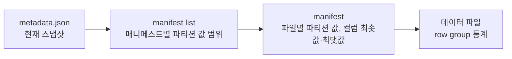

같은 이벤트 로그를 Hive 스타일 Parquet 테이블과 Iceberg 테이블에 하루 단위로 나눠 담았다고 하자. 쿼리는 같다.

```sql
SELECT count(*) FROM events
WHERE event_ts >= TIMESTAMP '2026-11-20 00:00:00'
  AND event_ts <  TIMESTAMP '2026-11-21 00:00:00';
```

Iceberg 테이블은 하루치 파일만 고른다. Hive 테이블은 `dt` 파티션 컬럼에 조건이 없으니 모든 파티션 디렉터리를 나열하고, 그 안의 Parquet 파일 footer를 하나씩 열어 본다. 둘 다 "파티션 프루닝"이라고 부르지만, 읽을 파일을 고르는 근거가 다르다. Hive는 디렉터리가 곧 파티션이라 경로를 나열해야 파일을 알 수 있다. Iceberg는 파일 목록 자체를 커밋 때 매니페스트에 적어 두므로 경로가 어떻게 생겼든 상관없다. 그래서 Iceberg는 파일을 해시 경로로 흩어 놓아도 프루닝이 그대로 된다. 버전은 Spark 4.3, Iceberg 1.12 기준이다.

## 핵심 키워드

| 키워드 | 한 줄 뜻 |
|---|---|
| partition pruning | 조건과 맞지 않는 파티션을 읽기 전에 빼는 일 |
| predicate pushdown | 파일 안의 row group 통계로 읽을 부분을 줄이는 일 |
| 메타스토어 | Hive 테이블의 파티션 목록과 각 파티션의 경로를 저장하는 DB |
| manifest list | Iceberg 스냅샷 하나가 가리키는 매니페스트 목록. 매니페스트마다 파티션 값의 범위를 적어 둔다 |
| manifest | 데이터 파일 목록. 파일마다 파티션 값, 행 수, 컬럼별 최솟값·최댓값을 적어 둔다 |
| hidden partitioning | 파티션 값을 원본 컬럼에서 변환 함수로 만들어, 쿼리가 원본 컬럼 조건만 줘도 파티션이 걸러지는 방식 |

## Hive: 파티션은 디렉터리 이름이다

Hive 스타일 테이블에서 파티션 하나는 디렉터리 하나다. `dt=2026-11-20/` 아래 Parquet 파일들이 그날 데이터이고, 메타스토어에는 `dt=2026-11-20` 파티션과 그 경로가 등록된다. 파티션 값은 파일 안이 아니라 경로에 있다.

엔진이 읽을 파일을 고르는 순서는 이렇다.

| 단계 | 하는 일 | 비용 |
|---|---|---|
| 1. 파티션 고르기 | 파티션 컬럼 조건을 메타스토어에 넘겨 맞는 파티션 목록을 받는다 | 메타스토어 호출. 파티션이 수만 개면 응답이 커진다 |
| 2. 파일 나열 | 고른 파티션마다 S3 경로를 LIST해서 파일 목록을 만든다 | 파티션마다 LIST 요청. 한 번에 키 1,000개까지 |
| 3. 파일 안 건너뛰기 | 파일마다 footer를 읽어 row group의 최솟값·최댓값으로 거른다 | 파일마다 footer range GET(스캔 태스크 안에서) |

1단계는 파티션 컬럼 조건에만 걸린다. Spark는 기본값(`spark.sql.hive.metastorePartitionPruning=true`)으로 이 조건을 메타스토어에 넘긴다. 위 쿼리는 `event_ts`에만 조건이 있고 `dt`에는 없으므로 1단계에서 아무것도 빠지지 않는다. 그래서 Hive 테이블에서는 조건을 두 번 쓴다.

```sql
WHERE dt = '2026-11-20'
  AND event_ts >= TIMESTAMP '2026-11-20 00:00:00'
  AND event_ts <  TIMESTAMP '2026-11-21 00:00:00'
```

`dt`와 `event_ts`가 같은 날을 가리키는지는 쓰는 쪽 코드만 안다. `dt`는 UTC로, `event_ts` 조건은 KST로 계산하면 쿼리는 에러 없이 돌지만 경계 쪽 9시간치 행이 빠진다. 2단계는 파일 목록을 저장해 두지 않아서 생기는 비용이다. 파티션이 많을수록, 파일이 작을수록 LIST와 footer 읽기가 쿼리 시간의 큰 몫을 차지한다. 메타스토어와 실제 디렉터리가 어긋나는 문제는 [Hive 파티션과 메타스토어 글](/posts/hive-partitions-and-metastore/)에, 파일 안 통계로 건너뛰는 3단계는 [컬럼 파일과 프루닝 글](/posts/columnar-files-and-pruning/)에 있다.

## Iceberg: 커밋 때 적어 둔 목록을 읽는다

Iceberg는 파일을 쓸 때 그 파일의 정보를 매니페스트에 함께 적는다. 읽는 쪽은 디렉터리를 나열하지 않고 이 메타데이터를 따라 내려간다.



| 단계 | 하는 일 | 거르는 근거 |
|---|---|---|
| 1. 매니페스트 고르기 | manifest list에서 파티션 범위가 조건과 겹치는 매니페스트만 연다 | 매니페스트마다 적힌 파티션 필드의 최솟값·최댓값 |
| 2. 파일 고르기 | 매니페스트의 파일 항목마다 파티션 값과 컬럼 통계를 조건과 비교한다 | 파일별 파티션 값, 컬럼별 lower/upper bound, null 수 |
| 3. 파일 안 건너뛰기 | 고른 파일의 row group 통계로 거른다 | Parquet footer |

차이는 두 가지다. 첫째, 파일 목록이 메타데이터에 있으니 S3 LIST가 없다. 파일 경로는 매니페스트에 적힌 전체 경로라서 파일이 어느 디렉터리에 있든 상관없다. 대신 metadata.json, manifest list, 매니페스트 파일을 GET으로 읽는다. 계획 비용이 파티션 수와 파일 수 대신 매니페스트 수와 크기를 따라간다. 둘째, 2단계에서 파티션 컬럼이 아닌 컬럼으로도 파일을 거른다. `user_id`로 정렬해서 쓴 테이블이면 `user_id = 42` 조건만으로 파일 대부분이 열리지도 않고 빠진다. Hive에서는 같은 판단을 하려면 3단계에서 파일을 하나씩 열어야 한다.

## hidden partitioning: 조건을 두 번 쓰지 않아도 된다

Iceberg 파티션은 원본 컬럼에 변환을 걸어 정의한다.

```sql
CREATE TABLE events (event_id bigint, user_id bigint, event_ts timestamp, payload string)
USING iceberg
PARTITIONED BY (days(event_ts));
```

`days(event_ts)` 값은 테이블 컬럼으로 드러나지 않는다. 쓸 때 Iceberg가 `event_ts`에서 계산해 매니페스트에 적고, 읽을 때는 `event_ts` 조건을 같은 변환으로 파티션 조건으로 바꾼다. 앞의 쿼리가 `event_ts` 조건만으로 하루치만 읽는 이유다. `dt` 컬럼을 따로 만들 일이 없으니 `dt`와 `event_ts`가 어긋날 수도 없다.

시각 단위 변환 말고도 `bucket`, `truncate`, `identity`가 있다. 변환 종류와 받는 타입은 [Iceberg 테이블 포맷 글](/posts/iceberg-table-format/)에 있다. 위 DDL의 `days`는 Spark 쪽 이름이고, 스펙과 Athena는 `day`라고 쓴다.

파티션 스펙을 바꿔도 옛 파일은 옛 스펙의 파티션 값을 그대로 갖고, 읽을 때 스펙마다 따로 조건을 바꿔 맞춘다. Hive는 파티션 기준을 바꾸려면 디렉터리 구조를 새로 만들고 데이터를 옮겨야 한다. 스펙을 바꾸는 과정은 [Iceberg 스키마·파티션 진화 글](/posts/iceberg-schema-and-partition-evolution/)에 있다.

## 두 방식 비교

| | Hive 스타일 Parquet | Iceberg |
|---|---|---|
| 파티션 값이 있는 곳 | 디렉터리 이름 | 매니페스트의 파일 항목 |
| 파일 목록을 얻는 법 | 파티션마다 S3 LIST | 매니페스트를 읽음 |
| 파티션 컬럼 | 실제 컬럼(`dt`). 쿼리가 직접 조건을 줘야 함 | 원본 컬럼의 변환. 원본 컬럼 조건으로 걸러짐 |
| 파일 단위로 거르는 근거 | 파일을 열어 footer를 봐야 함 | 매니페스트의 컬럼 통계로 열기 전에 거름 |
| 새 데이터 반영 | 외부 잡이 파일만 쓰면 파티션 등록(`MSCK REPAIR`, `ADD PARTITION`) 필요. Hive·Spark `INSERT`는 함께 등록 | 커밋하면 바로 보임 |
| 파티션 기준 변경 | 데이터를 다시 씀 | 스펙만 바꾸고 옛 파일은 그대로 |

## Iceberg에서도 건너뛰기가 약해지는 경우

매니페스트의 컬럼 통계가 있어도 쓸모가 없는 경우가 있다.

| 경우 | 이유 | 대응 |
|---|---|---|
| 데이터가 정렬되지 않음 | 파일마다 최솟값·최댓값 범위가 넓어 거의 모든 파일이 조건과 겹친다 | 테이블 정렬 순서를 정하거나 `rewrite_data_files`를 sort 전략으로 돌림 |
| 컬럼이 많은 테이블 | 기본으로 스키마 앞쪽 100개 필드(중첩 필드 포함)만 통계를 남긴다(`write.metadata.metrics.max-inferred-column-defaults`) | 자주 거르는 컬럼은 `write.metadata.metrics.column.<컬럼>`으로 지정 |
| 긴 문자열 | 기본 통계 모드가 `truncate(16)`이라 앞 16자로만 비교한다. 접두사가 같은 값이 많으면 거의 거르지 못한다 | 자주 거르는 컬럼만 `write.metadata.metrics.column.<컬럼>=full`로 바꾼다 |
| 매니페스트가 잘게 쪼개짐 | 작은 커밋이 쌓이면 매니페스트 수가 늘어 1단계가 느려진다 | `rewrite_manifests`로 합침 |
| 컬럼에 함수를 씌움 | `date(event_ts) = '2026-11-20'`처럼 파티션 변환과 다른 함수를 씌우면 엔진과 버전에 따라 파티션 조건으로 못 바꿀 수 있다 | `EXPLAIN`으로 확인하고, 되도록 원본 컬럼에 범위 조건을 쓴다 |

Hive 쪽에도 메타스토어 호출을 줄이는 방법이 있다. Athena의 파티션 프로젝션은 파티션 값과 위치를 Glue 조회 대신 테이블 속성으로 계산한다. 다만 데이터 파일 목록은 계산된 위치를 S3에서 나열해 얻고, 파티션 컬럼 조건을 직접 써야 하는 점도 그대로다.

## 묻고 답하기

Q. Iceberg 테이블도 S3에 `event_ts_day=2026-11-20/` 같은 폴더가 생기던데, 결국 디렉터리 기반 아닌가?

기본 경로 규칙이 파티션 값을 폴더 이름에 넣을 뿐이다. 읽을 때는 그 폴더를 나열하지 않고 매니페스트에 적힌 파일 경로를 쓴다. `write.object-storage.enabled`를 켜면 경로에 해시 구성요소가 들어가 파일이 흩어지는데, 그래도 프루닝은 똑같이 된다(이때도 `write.object-storage.partitioned-paths` 기본값이 true라 파티션 값은 경로에 남는다). 폴더 이름은 기본 경로 규칙일 뿐, 읽을 파일을 고를 때는 쓰이지 않는다.

Q. Hive 테이블에서 `event_ts` 조건만 주면 아무 이득이 없나?

파티션 단계에서는 없다. 모든 파티션을 나열하고 파일을 다 연다. 파일 안 단계에서는 row group의 `event_ts` 최솟값·최댓값으로 맞지 않는 row group을 건너뛰니 실제로 읽는 바이트는 줄 수 있다. 하지만 LIST와 footer 읽기는 파티션 수와 파일 수만큼 그대로 든다.

## 참고 자료

- [Apache Iceberg Spec: Manifests, Manifest Lists, Partitioning](https://iceberg.apache.org/spec/)
- [Apache Iceberg: Partitioning](https://iceberg.apache.org/docs/latest/partitioning/), [Performance: Scan planning](https://iceberg.apache.org/docs/latest/performance/)
- [Apache Iceberg: Table properties (write.metadata.metrics.*, write.object-storage.enabled)](https://iceberg.apache.org/docs/latest/configuration/)
- [Apache Iceberg: Spark procedures (rewrite_data_files, rewrite_manifests)](https://iceberg.apache.org/docs/latest/spark-procedures/)
- [Spark SQL: Hive tables, spark.sql.hive.metastorePartitionPruning](https://spark.apache.org/docs/latest/sql-data-sources-hive-tables.html)
- [Amazon S3 ListObjectsV2](https://docs.aws.amazon.com/AmazonS3/latest/API/API_ListObjectsV2.html), [Athena partition projection](https://docs.aws.amazon.com/athena/latest/ug/partition-projection.html)

## English summary

Both Hive-style Parquet tables and Iceberg tables prune partitions, but they pick files from different sources. A Hive table keeps the partition value in the directory name, so the engine asks the metastore for matching partitions, lists each partition's S3 prefix, and opens every file footer; a filter on the raw timestamp alone prunes nothing unless the query also filters the `dt` column. Iceberg writes each file's partition value and column bounds into manifests at commit time, so planning reads the manifest list and manifests, skips whole manifests and files before opening them, and never lists directories. Hidden partitioning turns a filter on `event_ts` into a filter on `days(event_ts)`, and partition specs can change without rewriting old files. Iceberg's file skipping still depends on clustered data, column stats limits, and compact manifests.
