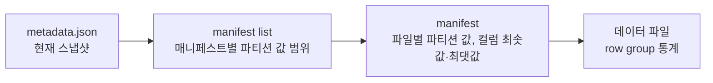

같은 이벤트 로그를 Hive 스타일 Parquet 테이블과 Iceberg 테이블에 하루 단위로 나눠 담았다고 하자. 쿼리는 같다.

```sql
SELECT count(*) FROM events
WHERE event_ts >= TIMESTAMP '2026-11-20 00:00:00'
  AND event_ts <  TIMESTAMP '2026-11-21 00:00:00';
```

Iceberg 테이블은 하루치 파일만 고른다. Hive 테이블은 `dt` 파티션 컬럼에 조건이 없으니 모든 파티션 디렉터리를 나열하고, 그 안의 Parquet 파일 footer를 하나씩 열어 본다. 둘 다 "파티션 프루닝"이라고 부르지만, 읽을 파일을 고르는 근거가 다르다. Hive는 디렉터리가 곧 파티션이라 경로를 나열해야 파일을 알 수 있다. Iceberg는 파일 목록 자체를 커밋 때 매니페스트에 적어 두므로 경로가 어떻게 생겼든 상관없다. 그래서 Iceberg는 파일을 해시 경로로 흩어 놓아도 프루닝이 그대로 된다. 버전은 Spark 4.3, Iceberg 1.12 기준이다.

## 핵심 키워드

| 키워드 | 한 줄 뜻 |
|---|---|
| partition pruning | 조건과 맞지 않는 파티션을 읽기 전에 빼는 일 |
| predicate pushdown | 파일 안의 row group 통계로 읽을 부분을 줄이는 일 |
| 메타스토어 | Hive 테이블의 파티션 목록과 각 파티션의 경로를 저장하는 DB |
| manifest list | Iceberg 스냅샷 하나가 가리키는 매니페스트 목록. 매니페스트마다 파티션 값의 범위를 적어 둔다 |
| manifest | 데이터 파일 목록. 파일마다 파티션 값, 행 수, 컬럼별 최솟값·최댓값을 적어 둔다 |
| hidden partitioning | 파티션 값을 원본 컬럼에서 변환 함수로 만들어, 쿼리가 원본 컬럼 조건만 줘도 파티션이 걸러지는 방식 |

## Hive: 파티션은 디렉터리 이름이다

Hive 스타일 테이블에서 파티션 하나는 디렉터리 하나다. `dt=2026-11-20/` 아래 Parquet 파일들이 그날 데이터이고, 메타스토어에는 `dt=2026-11-20` 파티션과 그 경로가 등록된다. 파티션 값은 파일 안이 아니라 경로에 있다.

엔진이 읽을 파일을 고르는 순서는 이렇다.

| 단계 | 하는 일 | 비용 |
|---|---|---|
| 1. 파티션 고르기 | 파티션 컬럼 조건을 메타스토어에 넘겨 맞는 파티션 목록을 받는다 | 메타스토어 호출. 파티션이 수만 개면 응답이 커진다 |
| 2. 파일 나열 | 고른 파티션마다 S3 경로를 LIST해서 파일 목록을 만든다 | 파티션마다 LIST 요청. 한 번에 키 1,000개까지 |
| 3. 파일 안 건너뛰기 | 파일마다 footer를 읽어 row group의 최솟값·최댓값으로 거른다 | 파일마다 footer range GET(스캔 태스크 안에서) |

1단계는 파티션 컬럼 조건에만 걸린다. Spark는 기본값(`spark.sql.hive.metastorePartitionPruning=true`)으로 이 조건을 메타스토어에 넘긴다. 위 쿼리는 `event_ts`에만 조건이 있고 `dt`에는 없으므로 1단계에서 아무것도 빠지지 않는다. 그래서 Hive 테이블에서는 조건을 두 번 쓴다.

```sql
WHERE dt = '2026-11-20'
  AND event_ts >= TIMESTAMP '2026-11-20 00:00:00'
  AND event_ts <  TIMESTAMP '2026-11-21 00:00:00'
```

`dt`와 `event_ts`가 같은 날을 가리키는지는 쓰는 쪽 코드만 안다. `dt`는 UTC로, `event_ts` 조건은 KST로 계산하면 쿼리는 에러 없이 돌지만 경계 쪽 9시간치 행이 빠진다. 2단계는 파일 목록을 저장해 두지 않아서 생기는 비용이다. 파티션이 많을수록, 파일이 작을수록 LIST와 footer 읽기가 쿼리 시간의 큰 몫을 차지한다. 메타스토어와 실제 디렉터리가 어긋나는 문제는 [Hive 파티션과 메타스토어 글](/posts/hive-partitions-and-metastore/)에, 파일 안 통계로 건너뛰는 3단계는 [컬럼 파일과 프루닝 글](/posts/columnar-files-and-pruning/)에 있다.

## Iceberg: 커밋 때 적어 둔 목록을 읽는다

Iceberg는 파일을 쓸 때 그 파일의 정보를 매니페스트에 함께 적는다. 읽는 쪽은 디렉터리를 나열하지 않고 이 메타데이터를 따라 내려간다.



| 단계 | 하는 일 | 거르는 근거 |
|---|---|---|
| 1. 매니페스트 고르기 | manifest list에서 파티션 범위가 조건과 겹치는 매니페스트만 연다 | 매니페스트마다 적힌 파티션 필드의 최솟값·최댓값 |
| 2. 파일 고르기 | 매니페스트의 파일 항목마다 파티션 값과 컬럼 통계를 조건과 비교한다 | 파일별 파티션 값, 컬럼별 lower/upper bound, null 수 |
| 3. 파일 안 건너뛰기 | 고른 파일의 row group 통계로 거른다 | Parquet footer |

차이는 두 가지다. 첫째, 파일 목록이 메타데이터에 있으니 S3 LIST가 없다. 파일 경로는 매니페스트에 적힌 전체 경로라서 파일이 어느 디렉터리에 있든 상관없다. 대신 metadata.json, manifest list, 매니페스트 파일을 GET으로 읽는다. 계획 비용이 파티션 수와 파일 수 대신 매니페스트 수와 크기를 따라간다. 둘째, 2단계에서 파티션 컬럼이 아닌 컬럼으로도 파일을 거른다. `user_id`로 정렬해서 쓴 테이블이면 `user_id = 42` 조건만으로 파일 대부분이 열리지도 않고 빠진다. Hive에서는 같은 판단을 하려면 3단계에서 파일을 하나씩 열어야 한다.

## hidden partitioning: 조건을 두 번 쓰지 않아도 된다

Iceberg 파티션은 원본 컬럼에 변환을 걸어 정의한다.

```sql
CREATE TABLE events (event_id bigint, user_id bigint, event_ts timestamp, payload string)
USING iceberg
PARTITIONED BY (days(event_ts));
```

`days(event_ts)` 값은 테이블 컬럼으로 드러나지 않는다. 쓸 때 Iceberg가 `event_ts`에서 계산해 매니페스트에 적고, 읽을 때는 `event_ts` 조건을 같은 변환으로 파티션 조건으로 바꾼다. 앞의 쿼리가 `event_ts` 조건만으로 하루치만 읽는 이유다. `dt` 컬럼을 따로 만들 일이 없으니 `dt`와 `event_ts`가 어긋날 수도 없다.

시각 단위 변환 말고도 `bucket`, `truncate`, `identity`가 있다. 변환 종류와 받는 타입은 [Iceberg 테이블 포맷 글](/posts/iceberg-table-format/)에 있다. 위 DDL의 `days`는 Spark 쪽 이름이고, 스펙과 Athena는 `day`라고 쓴다.

파티션 스펙을 바꿔도 옛 파일은 옛 스펙의 파티션 값을 그대로 갖고, 읽을 때 스펙마다 따로 조건을 바꿔 맞춘다. Hive는 파티션 기준을 바꾸려면 디렉터리 구조를 새로 만들고 데이터를 옮겨야 한다. 스펙을 바꾸는 과정은 [Iceberg 스키마·파티션 진화 글](/posts/iceberg-schema-and-partition-evolution/)에 있다.

## 두 방식 비교

| | Hive 스타일 Parquet | Iceberg |
|---|---|---|
| 파티션 값이 있는 곳 | 디렉터리 이름 | 매니페스트의 파일 항목 |
| 파일 목록을 얻는 법 | 파티션마다 S3 LIST | 매니페스트를 읽음 |
| 파티션 컬럼 | 실제 컬럼(`dt`). 쿼리가 직접 조건을 줘야 함 | 원본 컬럼의 변환. 원본 컬럼 조건으로 걸러짐 |
| 파일 단위로 거르는 근거 | 파일을 열어 footer를 봐야 함 | 매니페스트의 컬럼 통계로 열기 전에 거름 |
| 새 데이터 반영 | 외부 잡이 파일만 쓰면 파티션 등록(`MSCK REPAIR`, `ADD PARTITION`) 필요. Hive·Spark `INSERT`는 함께 등록 | 커밋하면 바로 보임 |
| 파티션 기준 변경 | 데이터를 다시 씀 | 스펙만 바꾸고 옛 파일은 그대로 |

## Iceberg에서도 건너뛰기가 약해지는 경우

매니페스트의 컬럼 통계가 있어도 쓸모가 없는 경우가 있다.

| 경우 | 이유 | 대응 |
|---|---|---|
| 데이터가 정렬되지 않음 | 파일마다 최솟값·최댓값 범위가 넓어 거의 모든 파일이 조건과 겹친다 | 테이블 정렬 순서를 정하거나 `rewrite_data_files`를 sort 전략으로 돌림 |
| 컬럼이 많은 테이블 | 기본으로 스키마 앞쪽 100개 필드(중첩 필드 포함)만 통계를 남긴다(`write.metadata.metrics.max-inferred-column-defaults`) | 자주 거르는 컬럼은 `write.metadata.metrics.column.<컬럼>`으로 지정 |
| 긴 문자열 | 기본 통계 모드가 `truncate(16)`이라 앞 16자로만 비교한다. 접두사가 같은 값이 많으면 거의 거르지 못한다 | 자주 거르는 컬럼만 `write.metadata.metrics.column.<컬럼>=full`로 바꾼다 |
| 매니페스트가 잘게 쪼개짐 | 작은 커밋이 쌓이면 매니페스트 수가 늘어 1단계가 느려진다 | `rewrite_manifests`로 합침 |
| 컬럼에 함수를 씌움 | `date(event_ts) = '2026-11-20'`처럼 파티션 변환과 다른 함수를 씌우면 엔진과 버전에 따라 파티션 조건으로 못 바꿀 수 있다 | `EXPLAIN`으로 확인하고, 되도록 원본 컬럼에 범위 조건을 쓴다 |

Hive 쪽에도 메타스토어 호출을 줄이는 방법이 있다. Athena의 파티션 프로젝션은 파티션 값과 위치를 Glue 조회 대신 테이블 속성으로 계산한다. 다만 데이터 파일 목록은 계산된 위치를 S3에서 나열해 얻고, 파티션 컬럼 조건을 직접 써야 하는 점도 그대로다.

## 어느 쪽이 나은가: S3 요청 비용, 속도, 운영

S3 요청 요금은 종류마다 다르다. S3 Standard(us-east-1) 기준으로 LIST는 1,000건에 0.005달러, GET은 1,000건에 0.0004달러라 LIST 한 번이 GET 12.5번 값이다. 일 파티션 365개에 파티션마다 파일 200개인 테이블에서 1년치를 읽는 쿼리를 예로 들면 이렇다.

| 요청 | Hive 스타일 | Iceberg |
|---|---|---|
| 메타데이터 | 메타스토어(Glue) 파티션 조회 몇 번 | metadata.json 1개, manifest list 1개, 매니페스트 GET(예: 수십 개) |
| 파일 목록 | 파티션마다 LIST, 365번 이상 | 없음 |
| 파일 열기 | 7만 3천 개 파일의 footer GET | 파티션 조건 외에 다른 조건이 있으면 컬럼 통계로 거르고 남은 파일만 |

쿼리 한 번의 요금은 둘 다 몇 센트 안쪽이라 크지 않다. 이 예에서는 LIST(약 0.2센트)보다 footer GET(약 3센트)이 비용 대부분을 차지한다. 차이는 두 군데서 커진다. 대시보드처럼 같은 쿼리가 하루 수천 번 돌 때, 그리고 파티션이 많아 LIST가 늘고 파일이 많은 경로는 LIST를 1,000개 단위로 이어서 돌려야 해서 계획 시간이 길어질 때다. 반대로 쓰기 쪽은 Iceberg가 요청을 더 쓴다. 커밋마다 매니페스트, manifest list, metadata.json을 새로 PUT하므로, 몇 초마다 커밋하는 스트리밍 적재는 메타데이터 파일이 빠르게 쌓인다.

| 관점 | Hive 스타일 Parquet | Iceberg |
|---|---|---|
| 읽기 요청 | 파티션 수만큼 LIST, 파일 수만큼 footer GET | 매니페스트 GET, 고른 파일만 열기 |
| 쓰기 요청 | 데이터 파일 PUT과 파티션 등록 | 데이터 파일 PUT에 커밋마다 메타데이터 PUT 몇 개 |
| 계획 속도 | 파티션과 파일이 많을수록 느려짐 | 매니페스트 수와 크기를 따라감 |
| 파일 건너뛰기 | 파티션 컬럼으로만, 나머지는 파일을 열어 봄 | 파티션과 컬럼 통계로 열기 전에 |
| 쓰는 중 읽기 | 비 ACID 테이블은 쓰다 만 파일이 보일 수 있음 | 커밋 전 파일은 보이지 않음 |
| 운영 작업 | 파티션 등록, 작은 파일 합치기 | 스냅샷 만료, 고아 파일 정리, 컴팩션, 매니페스트 합치기 |
| 바꾸기 어려운 것 | 파티션 기준, 컬럼 이름·순서 | 카탈로그 선택, 엔진 버전 호환 |

운영 부담은 사라지지 않고 자리를 옮긴다. Hive는 파티션을 제때 등록하고 메타스토어와 실제 폴더가 어긋나지 않게 맞추는 일이 중심이다. Iceberg는 등록이 필요 없는 대신 스냅샷과 메타데이터 파일이 쌓인다. `expire_snapshots`와 `remove_orphan_files`는 주기적으로, `rewrite_data_files`와 `rewrite_manifests`는 작은 파일이나 매니페스트가 쌓일 때 돌린다(Spark 프로시저 이름 기준). 이 정리를 빼먹으면 읽기 계획이 느려지고 S3 저장 비용이 는다.

고르는 기준은 이렇다.

| 이런 테이블이면 | 고르는 쪽 |
|---|---|
| 하루 한 번 쓰는 append 전용 배치, 파티션이 수백 개 이하, 쿼리가 늘 `dt` 조건을 줌 | Hive 스타일도 충분하다. Athena라면 파티션 프로젝션으로 Glue 조회를 줄인다 |
| 파티션이 수천 개를 넘거나 파일이 많아 계획 시간이 길다 | Iceberg |
| 파티션 컬럼이 아닌 컬럼으로 자주 거른다 | Iceberg + 그 컬럼으로 정렬 |
| CDC upsert, 삭제, 여러 잡이 동시에 쓴다 | Iceberg. S3 위 Hive 스타일(비 ACID)은 원자적 커밋이 없다 |
| 이력이 긴 CDC upsert 테이블인데 최신 변경은 바로 봐야 하고, 전체 이력을 Iceberg에 두면 컴팩션 비용이 테이블 크기를 따라간다 | 최근 며칠만 Iceberg에 두고 지난 이력은 매일 덤프한 Hive 일 파티션에서 읽는다(아래 묻고 답하기) |
| 파티션 기준이나 스키마가 바뀔 가능성이 있다 | Iceberg |
| 읽는 쪽이 Iceberg를 못 읽는 오래된 엔진이다 | Hive 스타일을 유지하거나 엔진부터 올린다 |

정리하면, 파티션과 파일이 많은 테이블에서는 읽는 쪽 비용과 속도, 그리고 정합성에서 Iceberg가 낫고, 그 대가로 메타데이터 정리 작업을 운영에 넣어야 한다. 쓰기가 단순하고 쿼리 모양이 고정된 작은 테이블에서는 Hive 스타일과 파티션 프로젝션으로도 충분하다.

## 묻고 답하기

Q. Iceberg 테이블도 S3에 `event_ts_day=2026-11-20/` 같은 폴더가 생기던데, 결국 디렉터리 기반 아닌가?

기본 경로 규칙이 파티션 값을 폴더 이름에 넣을 뿐이다. 읽을 때는 그 폴더를 나열하지 않고 매니페스트에 적힌 파일 경로를 쓴다. `write.object-storage.enabled`를 켜면 경로에 해시 구성요소가 들어가 파일이 흩어지는데, 그래도 프루닝은 똑같이 된다(이때도 `write.object-storage.partitioned-paths` 기본값이 true라 파티션 값은 경로에 남는다). 폴더 이름은 기본 경로 규칙일 뿐, 읽을 파일을 고를 때는 쓰이지 않는다.

Q. 하루 수억 건이 쌓이는 테이블도 Iceberg로 괜찮나?

행 수는 한계가 아니다. 계획 비용은 행 수가 아니라 파일 수와 매니페스트 수를 따라간다. 하루 3억 건, 건당 300 B면 원본 90 GB이고 Parquet으로 5분의 1쯤 줄면 18 GB다. 파일을 256 MB 안팎으로 쓰면 하루 70개 남짓, 1년이면 2만 6천 개 정도다. 매니페스트 몇십 개로 담기는 양이다.

문제는 쓰는 방식에서 생긴다. 스트리밍 잡이 1분마다 커밋하면 하루 1,440번 커밋하고, 커밋마다 writer 수만큼 작은 파일이 생긴다. 파일이 수십만 개로 늘고 스냅샷도 하루 1,440개씩 쌓인다. CDC upsert라면 delete 파일까지 쌓여 읽을 때마다 맞춰 봐야 한다. 그래서 수억 건 테이블은 행 수보다 커밋 주기, 컴팩션(`rewrite_data_files`), 스냅샷 만료(`expire_snapshots`), 매니페스트 합치기(`rewrite_manifests`)를 함께 정해야 버틴다. 같은 쓰기 방식이면 Hive 스타일도 작은 파일 문제를 똑같이 겪고, 거기에 LIST 비용이 더해진다.

append 전용이면 Iceberg가 가장 편한 경우다. delete 파일이 없어 읽을 때 맞춰 볼 것이 없고, 새 파일만 더하는 커밋끼리는 충돌도 거의 나지 않는다. 남는 일은 셋이다. 스트리밍으로 자주 커밋하면 작은 파일 컴팩션, 커밋마다 쌓이는 스냅샷 만료, 매니페스트가 잘게 늘면 매니페스트 합치기다. 하루 한 번 큰 파일로 쓰는 배치라면 스냅샷 만료 정도만 남는다.

Q. CDC로 받는 큰 결제 이력 테이블도 Iceberg 하나에 전부 두면 되나?

컴팩션이 sink 커밋을 따라갈 때만 된다. Iceberg는 낙관적 동시성 제어라 sink 커밋과 컴팩션 커밋이 부딪히면 나중 쪽이 다시 시도하고, 다시 시도해도 계속 부딪히면 실패한다. 컴팩션이 밀리면 그만큼 equality delete 파일이 쌓인다. 내가 맡은 CDC 테이블들은 upsert sink가 3분마다 커밋했고, S3 Tables 관리형 컴팩션이 `Internal error` 같은 오류로 반복 실패했다. 원인으로는 동시 쓰기 충돌을 의심했다. Athena CTAS로 다시 쓰는 것도 Athena 내부 오류로 실패했고, 수천만 건이 넘는 테이블을 Spark로 다시 쓰려면 클러스터를 키우고 CDC 수집을 잠시 멈추는 별도 조치를 검토해야 했다.

결제 이력 테이블은 행이 많았고, CDC 토픽이 이미 나오고 있었지만 Iceberg sink 대상에서 빠져 있었다. 그래서 원천 DB를 매일 05시에 떠 오는 Hive 일 파티션으로만 읽었다. 전날분만 적재하니 04시 59분에는 그제까지만 보여 최대 약 29시간 늦었다. 덤프는 그 순간의 스냅샷이라, 나중에 들어온 취소로 원거래의 취소 여부 컬럼이 바뀌어도 반영되지 않았다. 취소는 원거래 뒤 p99 3일, p99.9 24일, 길게는 519일 뒤에도 들어왔다.

이 테이블은 파티션 없는 upsert라 equality delete가 모든 데이터 파일에 걸리고, 컴팩션, dedup, 조회 스캔 비용이 Iceberg에 둔 행 수를 따라간다. 이 조건에서 고를 수 있는 구성은 넷이었다.

| 구성 | 최신 변경이 보이기까지 | 비용과 운영 부담 | 판단 |
|---|---|---|---|
| Hive 일 덤프만 | 최대 약 29시간, 덤프 뒤 취소는 안 보임 | 가장 적다 | 기각(그때 구성) |
| Iceberg에 전체 이력 | 약 3분 | 매일 dedup과 컴팩션이 전체 이력을 다시 쓴다. sink에서 뺀 이유와 같다 | 기각 |
| Iceberg 전체 이력 + 날짜 파티션 | 약 3분 | 지난 이력을 다시 쓰고 과거분을 다시 채워야 한다. 최근 파티션 컴팩션은 여전히 sink 커밋과 겹친다 | 기각 |
| Iceberg 최근 7일 + Hive 이력 | 약 3분 | Iceberg에 최근분만 둬 작다. 병합 쿼리와 취소 재덤프가 생긴다 | 채택 |

셋째 구성은 시간 컬럼이 Debezium이 보낸 epoch 밀리초 BIGINT라 `day` 대신 `truncate(86400000, ...)`로 하루를 잘라야 한다([Iceberg 테이블 포맷 글](/posts/iceberg-table-format/)). 한 테이블로 가려면 sink는 변경 로그를 append로만 쓰고 주기적인 MERGE가 본 테이블을 갱신하는 식으로 쓰는 쪽을 바꿔야 한다.

넷째 구성은 최신 변경이 필요한 구간만 Iceberg에 두고, 바뀔 일이 드문 지난 이력은 delete 파일 없는 Hive에 둔다. CDC를 다시 Iceberg로 받되 최근 며칠치만 남기고, 그보다 오래된 행은 매일 새벽 도는 dedup 잡이 지우게 했다. 남은 질문은 며칠을 둘지였다. dedup이 매일 테이블 전체를 다시 쓰고 컴팩션도 크기를 따라가니 보존 기간이 곧 비용이었다.

| 보존 | 크기 | 월 비용(추정) | 판단 |
|---|---|---|---|
| 3일 | 약 36 MB | 약 $0.2 | 최근 Hive 덤프가 하루만 빠져도 그날이 빈다 |
| 7일 | 약 85 MB | 약 $0.4 | 채택 |
| 90일 | 약 1.1 GB | 약 $4.5 | 비용은 10배인데 더 잡히는 취소는 0.22% 안쪽 |
| 13개월 | 약 4.7 GB | 약 $18 | 과거분을 다시 채우는 작업과 파티션 설계가 더 필요하다 |

비용은 컴팩션이 하루 한 번 테이블 전체를 다시 쓰고(S3 Tables 컴팩션 $0.05/GB) 대시보드 쿼리가 월 1,500번이라고 놓은 근사치다. 쿼리는 오늘을 포함한 최근 7일을 Iceberg에서 읽으니, 그 사이 Hive 덤프가 연휴에 실패하거나 늦어도 빈 날이 없다. 취소의 99.78%가 원거래 7일 안에 들어온다(3일이면 99.4%). Kafka 토픽 보존 기간(7~14일) 안이라 테이블이 깨져도 offset만 되돌리면 다시 채울 수 있다.

대신 두 곳으로 나누면 맞춰야 할 것이 생긴다.

| 나눠서 생기는 일 | 맞추는 방법 |
|---|---|
| 덤프한 뒤 바뀐 행(7일 밖 결제 취소) | 매일 아침 바뀐 원거래 날짜의 파티션을 다시 덤프한다 |
| 두 곳에 같은 결제가 있음 | `UNION ALL`로 합치고 키마다 Iceberg 행을 먼저 고른다 |
| 보존 일수와 쿼리 경계 | 지우는 잡의 보존 일수와 쿼리가 Hive로 넘어가는 경계를 같은 값으로 맞춘다 |
| sink가 보존 기간보다 오래 멈춤 | 지우는 잡이 테이블을 통째로 비우지 않게 DELETE 없이 실패한다 |

경계일(오늘에서 6일 전) 전날까지는 Hive만, 경계일부터는 Iceberg만 읽게 자르면 두 쪽이 겹치지 않는다. 경계를 넘겨 겹쳐 읽는 쿼리라면 아래처럼 `ROW_NUMBER`로 Iceberg 행을 고른다.

```sql
SELECT * FROM (
  SELECT t.*, ROW_NUMBER() OVER (PARTITION BY payment_id ORDER BY src, version DESC) AS rn
  FROM (
    SELECT payment_id, refunded, CAST(amount AS decimal(18,2)) AS amount, 0 AS src, cdc_offset AS version
    FROM iceberg.db.payments
    UNION ALL
    SELECT payment_id, refunded, CAST(amount AS decimal(18,2)), 1, 0
    FROM hive.db.payments WHERE dt >= '2026-11-01'
  ) t
) WHERE rn = 1;
```

`UNION`(DISTINCT)으로는 안 된다. DISTINCT는 모든 컬럼이 같은 행만 하나로 합치는데, 덤프 뒤 취소된 결제는 두 출처의 `refunded`가 달라 두 행이 그대로 남는다. 키마다 한 행을 고르려면 `ROW_NUMBER`가 있어야 한다.

Q. Hive 테이블에서 `event_ts` 조건만 주면 아무 이득이 없나?

파티션 단계에서는 없다. 모든 파티션을 나열하고 파일을 다 연다. 파일 안 단계에서는 row group의 `event_ts` 최솟값·최댓값으로 맞지 않는 row group을 건너뛰니 실제로 읽는 바이트는 줄 수 있다. 하지만 LIST와 footer 읽기는 파티션 수와 파일 수만큼 그대로 든다.

## 참고 자료

- [Apache Iceberg Spec: Manifests, Manifest Lists, Partitioning](https://iceberg.apache.org/spec/)
- [Apache Iceberg: Partitioning](https://iceberg.apache.org/docs/latest/partitioning/), [Performance: Scan planning](https://iceberg.apache.org/docs/latest/performance/)
- [Apache Iceberg: Table properties (write.metadata.metrics.*, write.object-storage.enabled)](https://iceberg.apache.org/docs/latest/configuration/)
- [Apache Iceberg: Spark procedures (rewrite_data_files, rewrite_manifests)](https://iceberg.apache.org/docs/latest/spark-procedures/)
- [Spark SQL: Hive tables, spark.sql.hive.metastorePartitionPruning](https://spark.apache.org/docs/latest/sql-data-sources-hive-tables.html)
- [Amazon S3 ListObjectsV2](https://docs.aws.amazon.com/AmazonS3/latest/API/API_ListObjectsV2.html), [Athena partition projection](https://docs.aws.amazon.com/athena/latest/ug/partition-projection.html)
- [Amazon S3 pricing (requests)](https://aws.amazon.com/s3/pricing/), [Apache Iceberg: Maintenance](https://iceberg.apache.org/docs/latest/maintenance/)
- [Amazon S3 Tables: Considerations for compaction](https://docs.aws.amazon.com/AmazonS3/latest/userguide/s3-tables-considerations.html)

## English summary

Both Hive-style Parquet tables and Iceberg tables prune partitions, but they pick files from different sources. A Hive table keeps the partition value in the directory name, so the engine asks the metastore for matching partitions, lists each partition's S3 prefix, and opens every file footer; a filter on the raw timestamp alone prunes nothing unless the query also filters the `dt` column. Iceberg writes each file's partition value and column bounds into manifests at commit time, so planning reads the manifest list and manifests, skips whole manifests and files before opening them, and never lists directories. Hidden partitioning turns a filter on `event_ts` into a filter on `days(event_ts)`, and partition specs can change without rewriting old files. Iceberg's file skipping still depends on clustered data, column stats limits, and compact manifests. Iceberg wins on read requests, planning time and consistency, and pays for it with metadata maintenance; an append-only daily table with a fixed `dt` filter can stay Hive style with partition projection. Managed compaction kept failing on my CDC upsert tables, and the large payment table had been left out of the CDC sink. Reading it only from a daily Hive dump made it up to 29 hours late and missed later refunds. The table has no partitions, so compaction and dedup cost grows with every row kept in Iceberg. I put it back into Iceberg but keep only the last seven days, and read older history from the Hive dump. Queries combine the two with UNION ALL and keep one row per payment with ROW_NUMBER. UNION DISTINCT is not enough, because a refund after the dump makes the two rows differ. Seven days is only about 85 MB. It catches 99.78% of refunds, and a dump that fails over a holiday leaves no gap. It also stays inside Kafka retention, so I can rebuild the table by resetting offsets.
