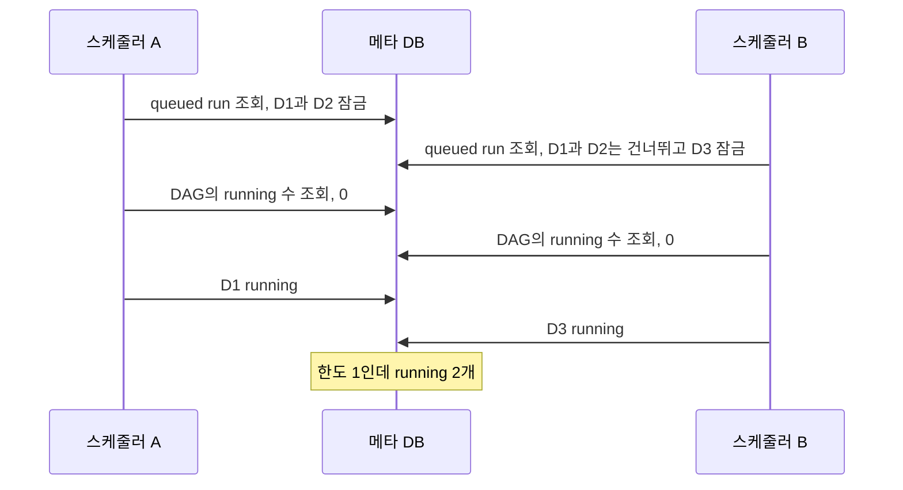

운영 중인 Airflow는 2.8.1이고 스케줄러를 2대 띄운다. 많은 run을 한꺼번에 다시 큐에 넣은 뒤, DAG 400개 가까이가 같은 상태로 멈췄다.

| run | 상태 | 기다리는 것 |
|---|---|---|
| 앞 날짜 run | queued | 실행 슬롯 |
| 뒤 날짜 run | running | 앞 날짜 run의 같은 태스크 (`depends_on_past=True`) |

`max_active_runs=1`이라 슬롯은 하나다. 뒤 날짜 run이 그 슬롯을 잡았고, 그 태스크들은 앞 날짜 run이 끝나기를 기다린다. 앞 날짜 run은 슬롯이 비기를 기다린다. 어느 쪽도 먼저 끝나지 않는다.

뒤 날짜 run이 먼저 running이 되는 길은 두 개였다. 하나는 스케줄러가 한 대여도 생기고, 다른 하나는 두 대 이상일 때만 생긴다. 그래서 PR도 둘로 나눴다.

## 정렬 키에 남은 옛 값

스케줄러는 루프마다 `DagRun.get_queued_dag_runs_to_set_running`으로 running으로 올릴 queued run을 고른다. main의 정렬은 이렇다.

```python
.order_by(
    nulls_first(BackfillDagRun.sort_ordinal, session=session),
    nulls_first(cls.last_scheduling_decision, session=session),
    nulls_first(running_drs.c.num_running, session=session),
    cls.run_after,
)
.limit(cls.DEFAULT_DAGRUNS_TO_EXAMINE)
```

`run_after`보다 `last_scheduling_decision`이 앞에 있다. 이 값은 run이 running일 때 스케줄러가 기록한다. 처음 만들어진 queued run은 모두 NULL이라 이 키에서 동률이 되고, 결국 `run_after` 순서로 뽑힌다. 2.8.1도 `last_scheduling_decision` NULLS FIRST를 `execution_date`보다 먼저 보고, main에도 이 순서가 그대로 남아 있다.

running이었다가 queued로 돌아간 run은 다르다. 끝난 run을 clear해서 queued로 되돌리면 `clear_task_instances`가 `last_scheduling_decision`과 `start_date`를 None으로 지운다. 그런데 UI의 "Mark run as queued"나 `PATCH .../dagRuns/{run_id}`에 `state=queued`를 보내면 `state`만 바뀐다. 뒤 날짜 run이 새로 만들어졌거나 clear로 돌아와 NULL이면, 옛 값이 남은 앞 날짜 run은 NULLS FIRST 정렬에서 그 뒤로 밀린다.

[#77603](https://github.com/apache/airflow/pull/77603)은 queued로 바꿀 때 clear가 하듯 이 두 값을 지운다.

```python
dag_run.state = state
if state == DagRunState.QUEUED:
    dag_run.last_scheduling_decision = None
    dag_run.start_date = None
```

테스트는 running run에 두 값을 채운 뒤 `set_dag_run_state_to_queued`를 부르고, 상태가 queued이고 두 값이 None인지 본다. 변경 없이 돌리면 `last_scheduling_decision` 검사에서 실패한다.

## 스케줄러 두 대가 각자 0을 센다

두 번째 길은 순서가 아니라 개수다. `max_active_runs=1`인데 같은 DAG의 run 두 개가 동시에 running이 된다.



`get_queued_dag_runs_to_set_running`은 고른 run 행을 `FOR UPDATE SKIP LOCKED`로 잠근다. 그래서 두 스케줄러가 같은 DAG의 서로 다른 run을 받는다. 그다음 `_start_queued_dagruns`가 DAG별 running 수를 세는데, 둘 다 아직 커밋 전이라 둘 다 0을 본다. 여기에 `depends_on_past`가 겹치면 D3는 D2를 기다린다. D1이 끝나도 D3가 슬롯을 쥐고 있어 D2는 queued에서 나오지 못한다.

평소에는 한 DAG에 queued run이 여러 개 쌓일 일이 드물어 잘 드러나지 않는다. 많은 run을 한꺼번에 clear하거나 다시 큐에 넣을 때 나온다.

backfill run에는 이 경쟁을 막는 코드가 이미 있었다. `_lock_backfills`가 `Backfill` 행을 `SKIP LOCKED`로 잠근 뒤에 개수를 세고, 다른 스케줄러가 잠근 backfill의 run은 그 루프에서 건너뛴다. [#77604](https://github.com/apache/airflow/pull/77604)는 일반 run에 같은 방식을 붙였다.

```python
locked_dag_ids = set(
    session.scalars(
        with_row_locks(
            select(DagModel.dag_id).where(DagModel.dag_id.in_(dag_ids)),
            of=DagModel,
            session=session,
            skip_locked=True,
        )
    )
)
```

running 수를 세기 전에 backfill이 아닌 후보 run들의 `dag` 행을 잠그고, 잠그지 못한 DAG의 run은 이번 루프에서 건너뛴다. 잠금은 기존 스케줄링 트랜잭션이 끝나면 풀린다. SQLite처럼 행 잠금이 없는 DB에서는 `FOR UPDATE SKIP LOCKED`가 SQL에서 빠져, 모든 DAG가 잠긴 것으로 처리되고 건너뛰는 run이 없다.

`test_concurrent_schedulers_respect_max_active_runs`는 Postgres와 MySQL에서 세션 두 개를 스케줄러 두 대처럼 쓴다. `DEFAULT_DAGRUNS_TO_EXAMINE=1`로 각 세션이 queued run을 하나씩만 보게 하고, 둘 다 결정하기 전에는 커밋하지 않는다. main에서는 `assert 2 == 1`로 실패하고, 변경 후에는 running이 1개다.

## 리뷰 중인 #64109에도 같은 정렬이 있었다

같은 정렬 키를 다른 PR에서도 만났다. [#64109](https://github.com/apache/airflow/pull/64109)는 queued run이 많은 DAG 때문에 다른 DAG가 굶는 문제를 고치는 PR로, 2026년 3월부터 리뷰가 이어지고 있다. DAG마다 `row_number()`로 순위를 매기는 윈도 함수를 넣는데, 그 DAG 안 순서도 `last_scheduling_decision NULLS FIRST`가 `run_after`보다 앞이었다.

이 PR의 head에서 재현 테스트를 돌렸다. queued run 3개 중 가장 앞 날짜 run에만 `last_scheduling_decision`을 넣으면 그 run이 아니라 두 번째 run이 running이 된다. 결과와 함께 DAG 안 순서를 아래처럼 바꾸자는 코멘트를 남겼다.

```python
func.row_number().over(
    partition_by=(DagRun.dag_id, DagRun.backfill_id),
    order_by=(BackfillDagRun.sort_ordinal, DagRun.run_after, DagRun.id),
)
```

`last_scheduling_decision`은 DAG 사이의 공정성을 위한 키라 바깥 `ORDER BY`에 남긴다. DAG 안에서는 run이 시작돼야 할 순서만 본다. `sort_ordinal`은 역순 backfill을 지키고, `run_after`는 partitioned backfill의 `logical_date`와 달리 NULL이 없으며, `id`는 동률을 끊는다. main에서 딴 브랜치에 이 순서를 넣었을 때 재현 테스트와 기존 `_start_queued_dagruns`, backfill, `max_active_runs` 테스트가 SQLite에서 통과했다.

## 왜 `dag` 행을, 왜 SKIP LOCKED로

경쟁은 같은 DAG의 서로 다른 run 사이에서 생긴다. run 행은 이미 잠그지만 run마다 다른 행이라 서로를 막지 못한다. 같은 DAG를 다루는 두 스케줄러가 공통으로 잠글 수 있는 행은 DAG당 하나인 `dag` 행이다. backfill이 `Backfill` 행을 잠그는 것과 같은 이유다.

잠긴 DAG를 기다리지 않고 건너뛰는 데도 이유가 있다. 같은 `dag` 행은 다른 스케줄러의 `dags_needing_dagruns`도 잠근다. 그 잠금을 기다리면 스케줄러 루프가 그 트랜잭션이 끝날 때까지 막힐 수 있다. 건너뛰면 그 DAG만 다음 루프로 밀린다. run은 queued로 남아 있어 잃는 것이 없고, 나머지 DAG는 계속 돈다.

## English summary

I run Airflow 2.8.1 with two schedulers. After many runs were re-queued at once, about 400 DAGs got stuck. They used `max_active_runs=1` and `depends_on_past=True`. A later run held the only slot and waited for an earlier run that could not start. I found two causes. Marking a run as queued kept its old `last_scheduling_decision`, so later runs were picked first. #77603 resets it, like clearing does. Two schedulers could also each count zero running runs before either one committed. #77604 locks the `dag` rows with `SKIP LOCKED` before counting, as backfills already do. I also commented on #64109, which used the same ordering inside each DAG. Inside one DAG, runs should start in date order. The fairness key belongs only between DAGs.
