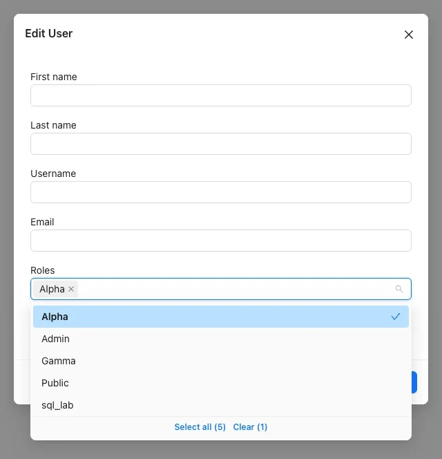
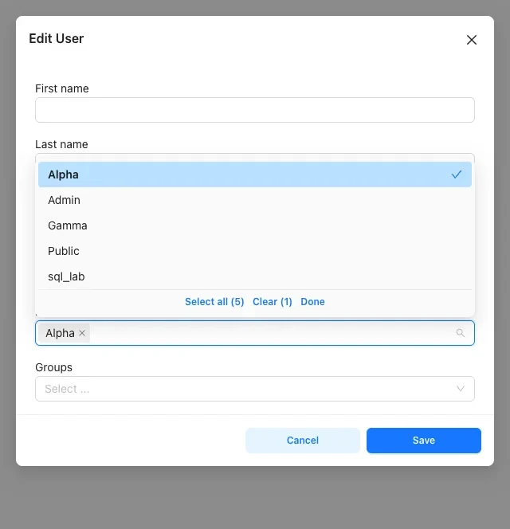
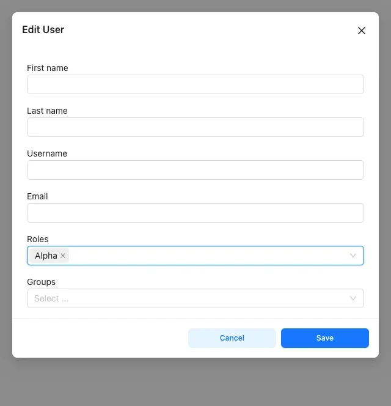

Superset의 List Users에서 사용자를 편집하다가 생긴 일이다. Roles 멀티 셀렉트를 열고 역할 하나를 고르면, 드롭다운이 모달 아래쪽의 Cancel과 Save를 덮는다.

{: width="640" height="664" }

저장하려면 빈 곳을 한 번 눌러 드롭다운을 닫고 Save를 다시 눌러야 했다. Esc도 드롭다운을 닫지만, 한 번 더 누르면 모달 전체가 닫히고 고친 내용이 사라진다.

## 화면 안에 있으니 뒤집지 않는다

antd Select는 팝업이 뷰포트 아래로 넘칠 때만 위로 뒤집는다. 모달 안에서는 팝업이 `.ant-modal-container`로 포털되는데, 이 컨테이너에는 모달 푸터도 들어 있다. 아래로 열린 팝업이 푸터 버튼을 덮어도 뷰포트 안에만 있으면, antd는 뒤집을 이유가 없다.

이 포털 구조는 [#45604](https://github.com/apache/superset/pull/45604)가 일부러 유지했고 `antdDomContract.test.tsx`가 검사한다. 그래서 포털 위치는 그대로 두고 방향만 바꾸기로 했다.

Superset의 셀렉트는 대부분 공통 `Select`와 `AsyncSelect`를 거친다. 사용자 편집 모달 하나가 아니라 모달 안의 셀렉트는 모두 같은 문제를 겪을 수 있어서, 고치는 위치도 공통 컴포넌트로 잡았다.

## 푸터까지 남은 거리로 방향을 정한다

[#46572](https://github.com/apache/superset/pull/46572)는 팝업을 열 때 트리거 아래에서 푸터 위까지의 공간을 잰다.

```tsx
const triggerRect = trigger.getBoundingClientRect();
const spaceBelow = footer.getBoundingClientRect().top - triggerRect.bottom;
const spaceAbove = triggerRect.top - modal.getBoundingClientRect().top;
if (spaceBelow >= estimatePopupHeight(rowCount)) return undefined;
if (spaceAbove <= spaceBelow) return undefined;
return direction === 'rtl' ? 'topRight' : 'topLeft';
```

아래 공간이 예상 팝업 높이보다 작고 위쪽이 더 넓을 때만 위로 연다. RTL이면 `topRight`다. 팝업은 모달 컨테이너 안에 그려지니, 위쪽 공간도 뷰포트가 아니라 모달 위 끝까지만 잰다. 뷰포트 위쪽이 넉넉해도 트리거가 모달 위 끝에 붙어 있으면 기본 배치를 그대로 두고, 이 경우도 테스트로 넣었다. 모달 밖에 있거나 푸터가 없으면 `undefined`를 돌려 antd 기본 배치를 그대로 쓴다.

팝업이 그려지기 전에 정해야 하니 높이는 추정한다.

| 항목 | 값 |
|---|---|
| 옵션 한 줄 | 32px |
| 목록 최대 높이 | 256px (antd 기본 `listHeight`) |
| 목록 여백과 푸터 줄 | 48px |
| 그룹 옵션 | 헤더 1줄 + 하위 옵션 수 |
| 도움말 문구 | 1줄 |

`AsyncSelect`는 열고 나서야 옵션을 불러온다. 옵션이 아직 없으면 `pageSize`만큼 있다고 보고 계산해서, 처음 열 때부터 방향이 맞는다.

방향은 열 때 한 번만 정한다. 열려 있는 동안 다시 재면 옵션을 고를 때마다 목록이 위아래로 튈 수 있다.

{: width="640" height="664" }

## 닫는 버튼 하나에 따라온 것들

멀티 셀렉트는 하나를 고를 때마다 팝업이 열린 채로 남는다. 여러 개를 고르라는 뜻이니 맞는 동작인데, 다 골랐을 때 닫는 방법이 따로 없었다. 그래서 Select all, Clear 옆에 Done을 넣었다.

Done만 넣어서는 닫히지 않았다. 팝업 안에서 mousedown이 일어나면 antd가 팝업을 다시 열기 때문에, 열림 상태를 `open={isDropdownVisible}`로 컴포넌트가 직접 쥐게 바꿨다. 호출하는 쪽이 `open`을 넘기면 뒤에 오는 `{...props}`가 덮어써서 그 값이 이긴다.

상태를 직접 쥐자 빈틈이 하나 생겼다. 열린 채로 셀렉트가 disabled가 되면 antd가 닫힘을 알려 주지 않는다. 필터처럼 열려 있는 셀렉트를 코드가 disabled로 바꾸는 경우다. 이때는 `props.disabled`가 켜지는 순간 직접 닫는다.

푸터 버튼 간격도 고쳤다. 원래 스타일은 `:first-of-type`과 `:last-of-type`에 padding을 따로 줘서 버튼이 정확히 두 개라고 가정했다. 버튼이 Done 하나이거나 셋이 되면 간격이 어긋나서, 모든 버튼에 같은 padding을 주고 간격은 `gap`에 맡겼다.

{: width="640" height="664" }

이제 모든 멀티 셀렉트 팝업에 푸터 줄이 생긴다. `allowSelectAll={false}`라 전에는 푸터가 없던 셀렉트도 Done 하나는 보인다. 번역 문자열 `t('Done')`도 새로 생긴다. 눈에 보이는 변화가 크고 겹침은 방향 변경만으로 해결되니, Done은 별도 PR로 나눌 수 있다고 PR 설명에 적었다.

Done은 마우스용이다. Tab을 누르면 포커스가 Done에 닿기 전에 팝업이 닫히는데, 기존 Select all, Clear도 같다. 키보드로는 첫 번째 Esc가 드롭다운만 닫는다.

jsdom에는 레이아웃이 없고 antd가 팝업 위치를 다시 맞추기 때문에, 방향 판단은 헬퍼 함수 단위로 테스트했다. 새 `popupFooter.test.tsx`는 Select와 AsyncSelect 각각에서 Done이 팝업을 닫고 선택을 유지하는지, 단일 선택에는 Done이 없는지, 닫은 뒤 클릭이나 입력으로 다시 열리는지 본다. 실제 배치는 사용자 편집 모달과 같은 구성을 Storybook에 만들어 Chrome 1280×900에서 확인했다.

## CI를 막은 건 master였다

PR의 `lint-frontend`가 실패했다. 로그의 에러는 내 변경과 상관없는 파일에서 나왔다.

```text
x import(no-named-as-default): Module "redux-mock-store" has named export "configureStore"
Found 2292 warnings and 1 error.
```

두 PR이 엇갈린 결과였다. [#46317](https://github.com/apache/superset/pull/46317)이 `import/no-named-as-default`를 에러로 올렸고, [#45824](https://github.com/apache/superset/pull/45824)가 `redux-mock-store`의 default export를 `configureStore`라는 이름으로 가져오는 테스트를 추가했다. 그 이름은 같은 모듈의 named export이기도 하다. 두 PR 모두 각자의 CI는 통과했다.

[#46582](https://github.com/apache/superset/pull/46582)는 import 이름을 `createMockStore`로 바꾼다. 같은 폴더의 `UsersList.test.tsx`를 비롯해 저장소의 다른 테스트 대부분이 쓰는 이름이다. 두 줄짜리 변경이고 동작은 그대로다.

## English summary

In Superset's user edit modal, the Roles multi-select dropdown covered the Cancel and Save buttons. Inside a modal, the popup renders in the modal container, which also holds the footer. The popup stays inside the viewport, so antd never flips it. My PR #46572 measures the space between the select and the footer when the popup opens. If the popup does not fit below and there is more room above, it opens upward. It also adds a Done button to multi-select popups. A lint error on master blocked CI, so I fixed it in #46582. I measure the direction only once per open, so the list does not jump while someone picks options.
