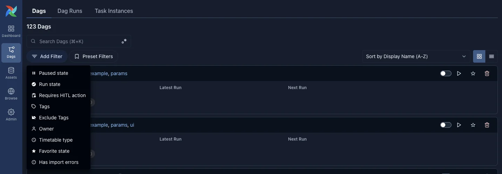
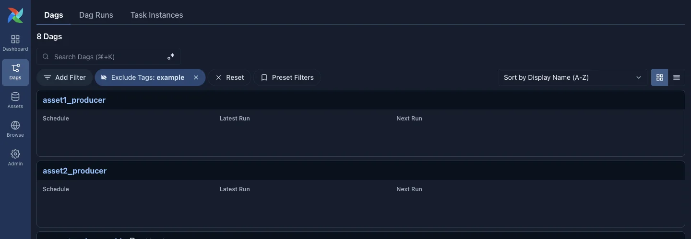
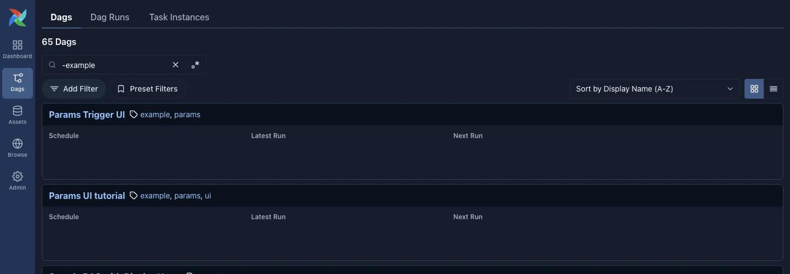

Airflow 3의 DAG 목록은 태그나 이름으로 좁힐 수는 있어도, 특정 DAG를 빼고 볼 수는 없었다. `deprecated` 태그가 붙은 DAG를 전부 숨기거나, 이름이 `test`로 시작하는 DAG만 빼고 보는 방법이 없었다. [#77622](https://github.com/apache/airflow/pull/77622)로 아래 두 요청을 쓸 수 있게 된다.

```text
GET /api/v2/dags?tags=team_a&exclude_tags=deprecated
GET /api/v2/dags?dag_display_name_pattern=etl|-test
```

## 태그로 빼기

`GET /api/v2/dags`, `PATCH /api/v2/dags`, UI 전용 DAG 목록 엔드포인트는 태그 필터로 같은 `QueryTagsFilter`를 쓴다. 여기에 `exclude_tags`를 더하니 세 곳에 한 번에 들어갔다.

```python
if self.value.exclude_tags:
    select = select.where(~DagModel.tags.any(DagTag.name.in_(self.value.exclude_tags)))
```

`DagModel.tags.any(...)`는 SQL에서 `EXISTS` 서브쿼리가 되고, 앞의 `~`로 `NOT EXISTS`가 된다. 주어진 태그 중 하나라도 달린 DAG는 빠지고, 태그가 아예 없는 DAG는 남는다. 태그를 조인해서 `tag.name NOT IN (...)`으로 걸었다면 태그 없는 DAG는 조인 결과에서 사라지고, 태그가 여러 개인 DAG는 다른 태그 행으로 살아남는다. "이 태그가 있으면 뺀다"는 뜻에는 `NOT EXISTS`가 맞다.

기존 `tags`, `tags_match_mode`와 함께 쓸 수 있다. 테스트에는 세 경우를 넣었다.

| 요청 | 결과 |
|---|---|
| `exclude_tags=example` | `example` 태그가 없는 DAG만 |
| `exclude_tags=example&exclude_tags=nonexistent` | 위와 같음. 없는 태그는 무시 |
| `tags=example&exclude_tags=example` | 0개 |

`PATCH /api/v2/dags`도 같은 필터를 쓰니, 여러 DAG를 한 번에 일시 정지할 때도 "이 태그만 빼고"가 된다. UI에는 Add Filter 메뉴에 Exclude Tags를 넣었고, 기존 태그 선택기를 그대로 쓴다.

{: width="1440" height="500" }

예제 DAG 123개 중 115개에 `example` 태그가 있다. `exclude_tags=example`을 걸면 8개가 남는다. 태그가 없는 `asset1_producer`도 그 8개에 들어 있다.

{: width="1440" height="500" }

## 검색창의 `-`

검색창은 이미 `|`를 OR로 쓴다. `etl|load`는 둘 중 하나와 맞는 DAG다. 여기에 `-`로 시작하는 검색어는 제외로 읽게 했다.

```python
terms = [term.strip() for term in (value.split("|") if pipe_as_or else [value]) if term.strip()]
excluded = [term[1:] for term in terms if term.startswith("-") and len(term) > 1]
if not excluded:
    return None
clauses = [not_(term_clause(term)) for term in excluded]
if included := [term for term in terms if not term.startswith("-")]:
    clauses.append(or_(*(term_clause(term) for term in included)))
return and_(*clauses)
```

`-`가 붙지 않은 검색어는 지금처럼 OR로 묶고, `-`가 붙은 검색어는 하나씩 `NOT`으로 뺀다. `etl|-test`는 `etl`과 맞으면서 `test`와는 맞지 않는 DAG이고, `-test`만 쓰면 `test`와 맞는 DAG를 뺀 전부다. `-` 하나만 입력하면 뺄 검색어가 없으니 `None`을 돌려, 예전처럼 `-`라는 글자를 찾게 한다.

`term_clause`를 인자로 받는 이유는 검색 파라미터가 두 갈래라서다. UI 기본 검색이 쓰는 `dag_display_name_prefix_pattern`은 접두 일치라, 인덱스를 타는 범위 조건(`>= 'etl' AND < 'etm'` 꼴)으로 바뀐다. 고급 검색이 쓰는 `dag_display_name_pattern`은 `ILIKE '%etl%'`인 부분 일치다. 두 파라미터 모두 원래 쓰던 조건 함수를 넘기면 되니, 제외 로직은 한 함수로 끝났다.

{: width="1440" height="500" }

`-example`로 검색하면 65개가 남는다. 표시 이름이 `example`로 시작하는 58개가 빠진 수다. 화면 맨 위의 `Params Trigger UI`에는 `example` 태그가 붙어 있는데도 남았다. 검색은 표시 이름(`dag_display_name`)만 보고 태그는 보지 않기 때문이다. 태그로 빼는 기능과 이름으로 빼는 기능을 따로 둔 이유다.

## `-`를 DAG 이름 검색에만 켠 이유

`-`를 제외로 읽는 건 동작 변경이다. 이전에는 DAG 이름 검색에 `-foo`를 넣으면 `-foo`라는 글자를 찾았다. 이제는 `foo`를 뺀다.

Airflow API에는 `*_pattern`, `*_prefix_pattern` 검색 파라미터가 많고, 그 값들이 `-`로 시작하지 않는다는 보장은 없다. 모든 파라미터의 뜻을 한꺼번에 바꾸면 영향 범위를 가늠하기 어렵다. 그래서 검색 파라미터 팩토리에 `minus_as_not` 옵션을 두고 기본값을 `False`로 했다. `dag_display_name_pattern`과 `dag_display_name_prefix_pattern` 두 곳에서만 `True`로 넘긴다.

```python
Depends(search_param_factory(DagModel.dag_display_name, "dag_display_name_pattern", minus_as_not=True))
```

켜진 파라미터는 OpenAPI 설명에 "A term prefixed with `-` excludes the values it matches"가 붙고, API 설명의 "Filtering with pattern parameters" 절에도 같은 규칙을 적었다.

API 테스트는 두 파라미터 각각에서 `-` 제외, `|`와 섞은 제외, `-` 하나만 넣은 경우를 본다. 옵션을 켜지 않은 `dag_id_pattern`에 `-1`을 넣는 경우도 넣었다. 이때는 `1`을 빼지 않고 `-1`이라는 글자를 그대로 찾아야 한다. UI 테스트는 URL의 `exclude_tags`가 DAG 목록 요청에 그대로 실리는지, 필터 칩으로 보이는지, Add Filter 메뉴에 항목이 있는지 본다.

## 검색창 하나로 합치기

PR은 11월 26일에 열었고 리뷰를 기다리고 있다. 이 PR로는 태그를 빼려면 필터를 열고, 이름을 빼려면 검색창에 써야 한다. GitHub 검색처럼 `tag:team_a -tag:deprecated`를 검색창에 바로 쓰는 방식은 [#77623](https://github.com/apache/airflow/issues/77623)으로 제안했다. 그 문법은 이번 PR의 `exclude_tags`와 `-` 규칙을 그대로 쓰기 때문에, 조건을 만드는 이 PR을 먼저 냈다.

## English summary

The Airflow 3 DAG list could filter by tags and by name, but it could not exclude anything. My PR #77622 adds `exclude_tags` to the DAG list endpoints. It also adds a `-term` syntax to the DAG name search. For example, `etl|-test` means names that match `etl` but not `test`. The tag exclusion uses `NOT EXISTS`, so DAGs without tags stay in the list. A leading `-` changes how a search term is read, and other pattern parameters may search for values that start with `-`. So I made it opt-in and turned it on only for the two DAG display name parameters.
