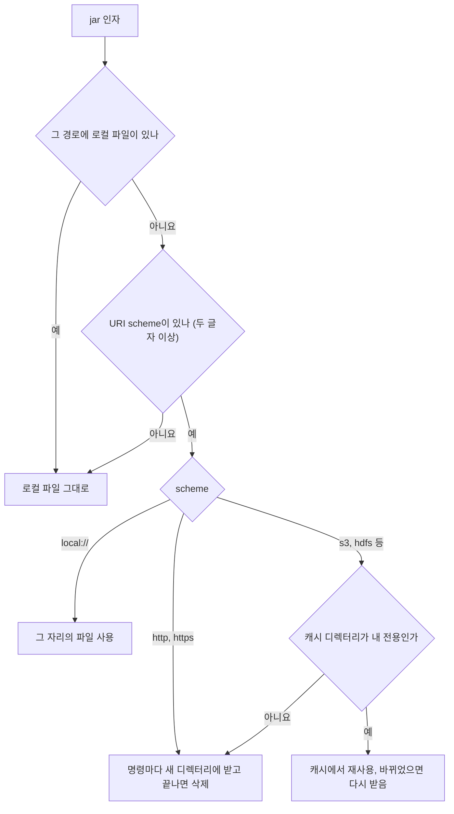

```text
$ flink run s3://my-bucket/jobs/job.jar
JAR file does not exist: s3:/my-bucket/jobs/job.jar
```

`flink run`에 S3 경로를 주면 이렇게 끝난다. 슬래시가 하나 빠진 건 CLI가 인자를 `java.io.File`로 만들면서 `//`를 `/`로 정규화했기 때문이다. CLI는 처음부터 이 값을 로컬 경로로만 봤다.

같은 요청이 [FLINK-6405](https://issues.apache.org/jira/browse/FLINK-6405) "Flink should be able to load a jar from s3"로 2017년 4월에 올라와 있었다. 2021년에 봇이 오래된 이슈로 표시한 뒤로는 움직임이 없었다.

그사이 Application Mode는 원격 JAR를 받게 됐다. Flink 1.19의 [FLINK-28915](https://issues.apache.org/jira/browse/FLINK-28915)가 `ArtifactFetchManager`로 `s3://`, `hdfs://` 같은 URI에서 JAR를 받아 온다. 세션 클러스터에 `flink run`으로 잡을 내는 쪽은 그대로였다. 잡을 낼 때마다 `aws s3 cp`로 JAR를 먼저 내려받아야 한다.

## 클라이언트에서 받는다

[#30140](https://github.com/apache/flink/pull/30140)은 CLI가 Application Mode와 같은 `ArtifactFetchManager`로 JAR를 직접 받게 한다. 받은 뒤로는 지금처럼 로컬 JAR를 클러스터에 올린다. 클러스터 쪽은 바뀌는 게 없다.

CLI에서 받으면 잡을 내는 사람의 자격 증명으로 받는다. 클러스터가 그 버킷을 읽을 권한을 가질 필요가 없다. REST로 잡을 낼 때 JobManager가 JAR를 받는 방식은 FLIP-613이 다룬다. 그쪽은 서버가 받고 이 PR은 CLI가 받으니, 둘 다 들어가도 부딪히지 않는다고 PR 설명에 적었다.

## 경로인지 URI인지

CLI 인자는 원래 로컬 경로다. 로컬 경로를 URI로 잘못 읽으면 지금까지 되던 명령이 깨진다.



같은 경로에 로컬 파일이 있으면 그 파일을 쓴다. `build:job.jar`는 `build`를 scheme으로 읽을 수 있는 상대 경로지만, 그 파일이 있으면 예전처럼 로컬 파일로 쓴다. scheme은 두 글자 이상일 때만 인정한다. 한 글자는 `C:\jobs\job.jar`의 드라이브 문자다. 공백이 든 경로는 URI 파싱에서 실패하는데, 그때도 로컬 경로로 본다. `local://`은 Application Mode에서 쓰던 표기라 CLI에서도 쓸 수 있게 했다. 이때는 내려받지 않고 그 경로의 파일을 그대로 쓴다.

## 한 번만 받기

JAR 하나로 잡 여러 개를 내는 경우가 많다. 명령마다 같은 JAR를 받지 않도록 `JobJarCache`를 새로 만들었다. 위치는 `io.tmp.dirs` 첫 항목 아래 `flink-cli-jar-cache`이고, 새 설정 옵션은 없다.

```java
FileStatus remoteStatus = remote.getFileSystem().getFileStatus(remote);
if (remoteStatus.getModificationTime() <= 0) {
    return Optional.empty(); // 캐시하지 않고 명령마다 받는다
}
String stamp = remoteStatus.getLen() + " " + remoteStatus.getModificationTime();

Path entry = Files.createDirectories(root.resolve(sha256Hex(jarUri)));
```

URI의 SHA-256으로 디렉터리를 나누고, Flink `FileSystem`에서 읽은 원격 파일의 길이와 수정 시각을 `.status` 파일에 적는다. 다음 명령에서 두 값이 같으면 다시 받지 않는다. `http(s)://`는 Flink `FileSystem`을 거치지 않고 HTTP 전용 fetcher로 받는다. 비교할 수정 시각이 없으니 캐시하지 않는다.

최신인지 확인은 명령마다 원격 파일 정보를 다시 읽어서 한다. 일정 시간 동안 확인을 건너뛰는 TTL은 없다. 다만 파일 내용은 비교하지 않는다. Flink `FileSystem` API의 `FileStatus`에는 체크섬이나 ETag가 없고, 이 API만으로 내용을 비교하려면 JAR를 받아야 해서 캐시를 두는 의미가 없어진다. 그래서 길이와 수정 시각이 모두 같으면 같은 파일로 본다. `file://` 경로에 `cp -p`를 쓰는 것처럼 수정 시각을 보존하는 방법으로 길이까지 같은 JAR를 덮어쓰면, 예전 JAR를 캐시해 둔 CLI는 그 JAR를 실행한다. 이렇게 올려야 한다면 새 파일 이름을 쓴다.

파일 시스템이 수정 시각을 주지 않으면(값이 0 이하) 비교할 값이 길이밖에 남지 않는다. 이런 파일은 캐시하지 않고 명령마다 받는다. 이 처리와 문서의 안내 문장은 11월 28일에 추가했다.

`ArtifactFetchManager`는 받을 디렉터리에 같은 이름의 파일이 있으면 다시 받지 않는다. 디렉터리를 재사용하면 원격 JAR가 바뀌어도 옛 JAR가 돈다. 그래서 캐시를 쓰지 않을 때는 명령마다 새 디렉터리에 받는다. 받은 파일은 명령이 끝나면 지우고, attached 모드로 잡을 기다리다 CLI가 중단돼도 `deleteOnExit`가 지운다.

## 캐시 디렉터리를 누가 쓸 수 있나

CLI는 캐시에 있는 JAR의 `main()`을 그대로 실행한다. 다른 사용자가 그 디렉터리에 쓸 수 있으면, 내 다음 `flink run`이 남이 넣은 코드를 돌린다. `io.tmp.dirs`의 기본값은 JVM 임시 디렉터리이고, 리눅스에서는 보통 여러 사용자가 같이 쓰는 `/tmp`다.

그래서 캐시를 열 때 디렉터리를 검사한다.

```java
return attributes.owner().equals(currentUser)
        && attributes.permissions().stream()
                .allMatch(permission ->
                        permission == PosixFilePermission.OWNER_READ
                                || permission == PosixFilePermission.OWNER_WRITE
                                || permission == PosixFilePermission.OWNER_EXECUTE);
```

심볼릭 링크가 아닌 실제 디렉터리이고, 주인이 현재 사용자이고, group과 other 권한이 하나도 없을 때만 쓴다. 새로 만들 때는 `rwx------`로 만든다. 조건이 어긋나면 경고 로그를 남기고 캐시 없이 명령마다 받는다. POSIX 권한을 읽을 수 없는 파일 시스템(Windows 등)에서도 캐시를 쓰지 않는다.

## 두 CLI가 동시에 받을 때

같은 JAR를 두 CLI가 동시에 받으면, 한쪽이 캐시의 JAR를 덮어쓰는 중에 다른 쪽이 읽을 수 있다. 각 CLI는 받은 JAR와 새 `.status`를 자기 임시 디렉터리에 먼저 쓰고, JAR를 먼저, `.status`를 나중에 `ATOMIC_MOVE`로 캐시 자리에 옮긴다.

두 파일을 한 번에 옮길 수는 없어서, 잠깐 새 JAR와 옛 `.status`가 같이 보일 수 있다. 이때 옛 `.status`는 원격 파일의 현재 길이, 수정 시각과 맞지 않는다. 그걸 본 CLI는 캐시를 믿지 않고 다시 받는다. `.status`가 원격 파일과 맞지 않는 JAR는 실행하지 않는다.

## 테스트와 지금 상태

새 `CliFrontendRemoteJarTest`는 목 객체 없이 테스트 안에 띄운 HTTP 서버와 실제 fetcher로 돈다. `file://`은 `s3://`와 같은 코드 경로라 캐시 재사용과 갱신은 `file://`로 본다. 기능을 하나씩 끄고 돌려서, 실패하는 테스트가 있는지도 봤다.

| 일부러 끈 것 | 실패한 테스트 |
|---|---|
| 원격 fetch 분기 | 5개 |
| 캐시 | 2개 (재사용, 갱신) |
| 권한 검사 | 2개 (보안) |

11월 28일에는 테스트 두 개를 더했다. 위 표는 이 두 개를 더하기 전 결과다. 수정 시각은 그대로 두고 길이만 바꾸면 다시 받는지, 수정 시각이 없는 JAR를 캐시하지 않는지 본다. 뒤의 테스트는 수정 시각 확인 코드를 빼면 실패한다. 새 테스트를 포함한 `CliFrontend*Test` 98개가 모두 통과했다. 2.3.0 배포판에 `flink-s3-fs-hadoop` 플러그인을 넣고 실제 S3 버킷으로도 돌렸다. 첫 `flink run s3://...`은 JAR를 받아 `main()`까지 실행했고, 두 번째 실행은 받지 않고 `Reusing cached job JAR ...` 로그를 남겼다. 캐시 디렉터리는 `drwx------`였다.

문서는 `deployment/cli.md` 영문과 중문에 URI 형식과 캐시 규칙을 적었다. PR은 11월 26일에 draft로 열었다. CLI 동작이 바뀌는 일이라 FLIP이 필요한지부터 정해야 한다. 그래서 dev@ 메일링 리스트에 "[DISCUSS] FLINK-6405: Let flink run fetch the job JAR from a remote URI"를 보내고 JIRA에 담당을 요청했다. 11월 28일에는 draft를 풀고 리뷰를 받을 수 있게 열었다.

## English summary

Since 2017, FLINK-6405 has asked for `flink run` to load a job JAR from S3. Application Mode can already fetch remote JARs, but the CLI for session clusters only takes local paths. My PR #30140 lets `flink run` and `flink info` fetch the JAR on the client, using the `ArtifactFetchManager` that Application Mode uses. JARs from `s3://` or `hdfs://` are cached, so several jobs from one JAR download it only once. A cached copy is checked against the remote length and modification time on every command; the content itself is not compared, and a file without a modification time is not cached. The CLI runs the cached code, so the cache is used only when its directory belongs to the current user and nobody else can access it.
